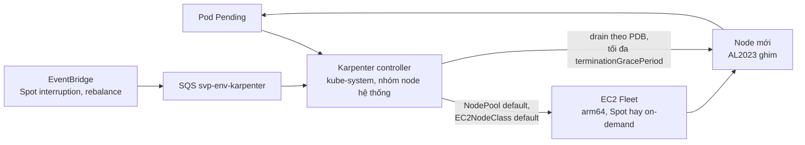
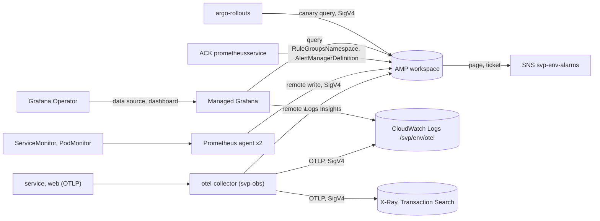

# Thành phần của GitOps

Trang giải thích cấu hình đáng chú ý của từng thành phần ở `base/`, `platforms/`, `envs/` và `argocd/`, và lý do của nó. Danh sách
thành phần, wave và nền tảng mỗi thành phần chạy nằm ở `argocd/apps/components.json`; cấu trúc repo, root hai tầng, lớp nền tảng, hợp đồng giá trị
`cluster`, promote và check nằm ở [`README.md`](../README.md). Các mục xếp theo thứ tự: Argo CD và root của nó, rồi các thành phần theo wave.

## Mục lục

- [Ghim image theo digest](#ghim-image-theo-digest)
- [Argo CD](#argo-cd)
- [Argo CD root (argocd/root, argocd/apps)](#argo-cd-root-argocdroot-argocdapps)
- [AppProject svp](#appproject-svp)
- [Karpenter](#karpenter)
- [cert-manager](#cert-manager)
- [Envoy Gateway](#envoy-gateway)
- [External Secrets](#external-secrets)
- [svp-cluster](#svp-cluster)
- [AWS Load Balancer Controller](#aws-load-balancer-controller)
- [CloudNativePG](#cloudnativepg)
- [Reloader](#reloader)
- [Argo Rollouts](#argo-rollouts)
- [Kyverno](#kyverno)
- [KEDA](#keda)
- [kube-prometheus-stack](#kube-prometheus-stack)
- [ACK prometheusservice controller](#ack-prometheusservice-controller)
- [Grafana Operator](#grafana-operator)
- [Barman Cloud plugin](#barman-cloud-plugin)
- [Loki](#loki)
- [Tempo](#tempo)
- [svp-data](#svp-data)
- [OpenTelemetry Collector](#opentelemetry-collector)
- [Telemetry trên EKS](#telemetry-trên-eks)

## Ghim image theo digest

Image trong values được ghim theo digest của multi-arch index (`linux/amd64` và `linux/arm64`); tag của chart (`appVersion` hay version)
ghi cạnh để người đọc. Lý do: tag có thể bị đẩy lại sang nội dung khác, digest thì không. Chart render `repository:tag` nên `tag` giữ
`version@digest`; `pin_check` của `deploy/ci/gitops-check.sh` ở repo code báo lỗi với image không có digest.

Renovate (helm-values manager) chỉ thấy một pin ở dạng `repository` và `tag` dưới khoá kết thúc bằng "image", và cập nhật cả hai phần
của `tag`. Vì vậy `repository` (và `registry` khi chart có khoá đó) được viết ra đúng mặc định của chart.
Khi khoá của chart không kết thúc bằng "image" (KEDA, Tempo), dòng `# renovate:` ngay trên mỗi `tag` nêu image cho custom manager cập nhật
nó (registry và repository mặc định của chart). Khác biệt riêng của từng thành phần ghi ở mục của nó.

## Argo CD

Argo CD (chart `argo-cd` của `argoproj.github.io/argo-helm`), release `argocd` ở namespace `argocd`: đường GitOps. Bootstrap cài nó ở
version của `argocd/bootstrap.json`, trước mọi thứ khác (k3d: `deploy/k8s/gitops.sh` của repo code; EKS: `helm_release` của root
`aws/gitops/<env>` ở repo hạ tầng, mẫu GitOps Bridge). Nó không nằm trong `components.json`: nó dựng phần còn lại của cluster từ GitHub.

Bản cài tối giản: chỉ application controller, repo-server, server và Redis. Đăng nhập bằng user admin cục bộ (mật khẩu ở Secret
`argocd-initial-admin-secret`, lệnh `make k8s-ui-argocd` in cách đọc); server là Service ClusterIP, chỉ vào được qua port-forward trên
`127.0.0.1` ([mô hình mối đe doạ](https://github.com/anhnvcoder/svp-backend/blob/main/docs/threat-model.md), OPS-2).

ApplicationSet controller: chart không có công tắc bỏ nó, nên zero replica để Deployment của nó không có pod. Một `components.json` đã liệt
kê mọi Application. Nền tảng `eks` bật nó (`platforms/eks/argo-cd.yaml`) cho ApplicationSet duy nhất của GitOps Bridge, cái tạo root.

Trên `eks` Argo CD cũng là bản tự cài này: mỗi thành phần một replica, đăng nhập bằng user admin cục bộ. Hướng đi cho prd (EKS Capability
cho Argo CD: AWS chạy và giữ HA, đăng nhập qua IAM Identity Center, không tài khoản cục bộ) và lý do nằm ở
[ADR-0065](https://github.com/anhnvcoder/svp-backend/blob/main/docs/adr/0065-argocd-eks-capability.md) của repo code; nó đổi cách cài và
đích của Application, nên không phải values ở đây.

### Server-side diff

Bật cho mọi Application trừ hai tầng root. Controller so object đang chạy với kết quả của dry-run server-side apply của manifest, nên các
giá trị mặc định mà API server điền (`group`, `kind` và `weight` của `backendRefs` trong Gateway API và `match` mặc định của route,
`apiVersion` và `kind` của `volumeClaimTemplates` trong StatefulSet, `protocol` của port) có ở cả hai phía. Diff mặc định so chính
manifest, vốn thiếu chúng: các Application `svp-cluster`, `svp-data` và `gateway` ở yên OutOfSync trên cluster mới và `selfHeal`
sync lại chúng mãi.

- `ignoreDifferences` vẫn áp cho cả hai phía (`pkg/diff/diff.go`, `serverSideDiff` của gitops-engine); hook không bao giờ bị dry-run apply
  (chúng nằm ngoài phép so).
- Dry run không cần quyền nào khác: ClusterRole của controller đã cho mọi thứ.
- Cái giá: một dry-run apply cho mỗi resource và mỗi lần so, được cache tới khi refresh, có revision mới, spec của Application đổi hay
  `resourceVersion` của object đang chạy đổi.
- Controller đọc nó qua biến `ARGOCD_APPLICATION_CONTROLLER_SERVER_SIDE_DIFF` trong StatefulSet của nó.
- Hai tầng của root, `svp-root` và `svp-apps` (`argocd/root`), tắt nó bằng annotation `argocd.argoproj.io/compare-options:
  ServerSideDiff=false`: chúng apply các Application con theo client-side, và một dry-run server-side sẽ không thấy field bị xoá khỏi
  chúng. Các Application con apply object của chính chúng theo server-side.

### Chu kỳ đọc repo

Argo CD poll GitHub: cluster trên máy này không nhận được webhook của GitHub. Chu kỳ 60 s, không jitter: jitter mặc định 60 s của chart làm
controller trễ mỗi lần refresh định kỳ thêm 0–60 s ngẫu nhiên, nên chu kỳ thật là 60–120 s. Repo-server cache các ref của repo cùng 60 s đó
và dùng chung cho mọi Application của repo, nên một lần push được thấy trong khoảng 60 s, tệ nhất khoảng 120 s.

### Kyverno report

`resource.exclusions` để mặc định của chart, vốn đã khiến Argo CD không theo dõi các kind report của Kyverno, gồm bốn kind Kyverno v1.19.1
ghi (`PolicyReport` và `ClusterPolicyReport` của `wgpolicyk8s.io`, `EphemeralReport` và `ClusterEphemeralReport` của `reports.kyverno.io`):
reports controller tạo một report cho mỗi pod và policy, không chart nào render chúng, và theo dõi chúng chỉ tốn RAM của application
controller. Đặt `resource.exclusions` ở đây sẽ thay cả danh sách mặc định; loại trừ riêng của dự án đi vào `resourceExclusionsAdditional`,
chart nối nó vào danh sách đó.

### Health của Application

Từ Argo CD 1.8 không còn đánh giá health của một Application, nên app-of-apps sẽ bắt đầu mỗi sync wave ngay khi các Application của wave
trước được apply, không đợi operator, CRD và database của chúng sẵn sàng (đường dev làm điều đó bằng `helm --wait`). Health Lua ở
`resource.customizations` khôi phục việc đợi, xuất phát từ Lua của `docs/operator-manual/health.md` ở v3.5.5 (mục "Argocd App") vốn chỉ
chuyển `status.health` đi. Thế chưa đủ, vì hai lý do:

- `status.health` bỏ hook (`controller/health.go`), nên một Application có Job PostSync (`pg-bootstrap` của `svp-data`, tạo database và
  role) còn chạy hay đã lỗi vẫn đã tính là Healthy và để wave sau bắt đầu.
- `status` là kết quả lần so sánh gần nhất của controller: sau khi tầng cha apply một spec mới (promote đổi image trong `valuesObject`),
  controller chỉ so nó ở lượt kế ("spec.source differs", `needRefreshAppStatus` của `controller/appcontroller.go`). Tới lúc đó Synced và
  Healthy của spec cũ khiến tầng cha, rồi root `svp-root`, Healthy ở commit mới, và Argo CD Notifications ghi `argocd/<env>` success lên nó
  trước khi bản mới chạy.

Khi nào một Application con là Progressing, Degraded hay Healthy: mục "Root hai tầng và bootstrap" của [`README.md`](../README.md#root-hai-tầng-và-bootstrap).
Chi tiết thêm:

- Degraded cần sync lỗi đó làm cho `spec.source` (`spec.sources`) hiện tại và, nếu chưa Synced, cả các revision hiện tại, như
  `alreadyAttemptedSync` của `controller/appcontroller.go` so (một sync không có kết quả cũng tính là làm cho chúng ở đó): automated sync
  sẽ không thử lại chúng. Sync của root lỗi kèm message thay vì đợi.
- Một sync lỗi của source cũ để Application ở Progressing: khi nó còn OutOfSync thì automated sync của source hiện tại sắp tới; khi đã
  Synced thì không có cái nào tới, và deadline của `deploy/k8s/gitops.sh` nêu tên nó.
- Source của một sync đã Succeeded không được so: Synced trong lần so sánh của spec hiện tại đã nói resource của nó được apply, và một
  Application mà spec mới render ra đúng cái đang chạy thì không có sync nào, nên nó sẽ đợi mãi (promote prd dời revision của values source
  của mọi component).
- Source được so từng khoá, danh sách theo vị trí. Controller ghi `comparedTo` và `syncResult` từ struct Go, JSON của chúng bỏ giá trị zero
  (`omitempty`), còn `spec` giữ cái manifest ghi, nên một khoá vắng ở một phía bằng giá trị zero (`""`, `false`, `0`, map hay danh sách rỗng)
  ở phía kia. Không áp cho `valuesObject`, cái controller sao nguyên (`runtime.RawExtension`): ở đó `false` hay `0` là giá trị Helm đọc.
- Lua không thấy `null` trong `valuesObject` (đọc như khoá bị bỏ), cũng không phân biệt `{}` với `[]` (một table rỗng): check của repo này
  (`deploy/ci/gitops-tree-policies/envs.rego` của repo code) từ chối cả hai trong overlay và file image, những chỗ điền `valuesObject`.
  Test: `argocd/root/application-health-test.sh`.

### Health của Alertmanager

Argo CD v3.5.5 có health check cho Prometheus (`resource_customizations/monitoring.coreos.com/Prometheus`) nhưng không có cho
Alertmanager, nên Application `kube-prometheus-stack` sẽ báo Healthy khi pod của Alertmanager còn đang khởi động; `deploy/k8s/install.sh`
đợi condition `Available` của nó trên đường dev. Operator đặt cùng hai condition trên cả hai: `Available` từ các pod ready của
StatefulSet, `Reconciled` từ lần reconcile gần nhất của resource. Một Alertmanager là:

- **Progressing** khi chưa có condition, khi một condition thuộc generation cũ, hay khi `Available` không phải True (pod đang khởi động:
  `StatefulSetNotFound`, `NoPodReady`, `SomePodsNotReady`). Không phải Degraded như check của Prometheus có cho `NoPodReady`: một resource
  Degraded làm hỏng sync wave đang đợi nó, và mọi Alertmanager mới đều bắt đầu khi chưa pod nào ready. Một pod không bao giờ ready giữ nó ở
  đây tới deadline của `deploy/k8s/gitops.sh`.
- **Degraded** khi `Reconciled` là False: operator không apply được resource (một Secret cấu hình không đọc được hay không parse được).
- **Healthy** khi `Available` là True.

### Health của ImageValidatingPolicy

Argo CD v3.5.5 chỉ có health check cho `kyverno.io/Policy` của Kyverno, nên Application `svp-policy` (wave 3) sẽ Healthy ngay khi
ImageValidatingPolicy của nó được apply, trước khi Kyverno biên dịch nó và đăng ký webhook, và các service (wave 7) có thể bắt đầu trước
khi có pod nào của `svp` bị kiểm (`deploy/k8s/install.sh` đợi cùng điều đó trên đường dev). Kyverno v1.19.1 đặt
`status.conditionStatus.ready` khi mọi condition là True (`WebhookConfigured`: policy đã ở trong webhook; `RBACPermissionsGranted`). Một
ImageValidatingPolicy là:

- **Healthy** khi `ready` là true.
- **Progressing** trong các trường hợp còn lại, kèm condition đầu tiên không phải True. Không bao giờ Degraded, như check của Argo CD cho
  `kyverno.io/Policy`: một policy Kyverno không biên dịch được ở yên Progressing tới deadline của `deploy/k8s/gitops.sh`, cái nêu tên nó.

Status không mang `observedGeneration`: sau một thay đổi trong git, `ready` vẫn là của generation trước tới khi Kyverno reconcile, điều ít
quan trọng một khi webhook đã có.

### Image

Khoá `global.image.tag` là image của mọi thành phần Argo CD (controller, repo-server, server, ApplicationSet controller để zero replica,
Job ghi mật khẩu Redis); label version của chart biến nó thành `v3.5.5-sha256-<vài hex đầu>`, một giá trị label hợp lệ. `repository` là mặc
định của chart viết ra. Quy ước chung ở [Ghim image theo digest](#ghim-image-theo-digest).

### Báo trạng thái triển khai trên EKS

`platforms/eks/argo-cd.yaml` bật ApplicationSet controller và Argo CD Notifications ([ADR-0032](https://github.com/anhnvcoder/svp-backend/blob/main/docs/adr/0032-argocd-deploy-status.md)
A, B của repo code). Bootstrap của một cluster EKS (`helm_release` của root `aws/gitops/<env>` ở repo hạ tầng, GitOps Bridge) đọc nó sau
`base/argo-cd.yaml`, ở commit của repo này mà nó bootstrap. Chỉ cluster sống suốt buổi mới báo: các cluster k3d của runner giữ
notifications tắt của `base/`, nên chúng không ghi status lên commit. ApplicationSet `svp-bootstrap` sinh root `svp-root` từ Secret cluster và
root ghi commit status bằng GitHub App ở các mục "Root hai tầng và bootstrap" và "Lớp nền tảng" của [`README.md`](../README.md).
Chi tiết thêm:

- Cái báo là riêng root `svp-root`: nó chỉ Healthy khi mọi wave của các con đã sync và Healthy, nên một commit status `argocd/<env>` cho
  mỗi commit của svp-gitops cho biết cả môi trường đã lên chưa, thay vì một status cho mỗi Application. Bootstrap gắn nhãn
  `svp.io/notify=root` cho root, cái mà subscription chọn.
- Credential đến từ Secret `argocd-notifications-secret`, do External Secrets dựng từ chart `svp-cluster` (`externalSecrets.argocdNotifications`,
  bật ở `svp-cluster.yaml` cạnh file đó), nên chart Argo CD không tạo Secret nào:
  - GitHub App `svp-argocd-notifier`: Commit statuses read và write chỉ trên svp-gitops, không gì khác;
  - Telegram bot của Alertmanager. Chat nó ghi tới không phải giá trị của repo public này: bootstrap thêm người nhận đó vào subscription
    của root khi có đặt (annotation `svp.io/telegram-chat-id` của Secret cluster, một biến của repo hạ tầng không bao giờ commit); không có
    thì chỉ gửi commit status.
- Không có `argocdUrl`: server là Service ClusterIP đi qua port-forward (OPS-2 của mô hình mối đe doạ), nên một status không mang link.

## Argo CD root (argocd/root, argocd/apps)

Root có hai tầng; mô tả và lý do ở mục "Root hai tầng và bootstrap" của [`README.md`](../README.md). Dưới đây là các chi tiết của chart.

### Tầng 1: `argocd/root`

Root Application `svp-root` đọc chart này từ svp-gitops và đặt values của nó; ai tạo nó, revision nó theo dõi, R, các value `envFiles` và các
phép kiểm lúc render ở mục "Root hai tầng và bootstrap" của [`README.md`](../README.md#root-hai-tầng-và-bootstrap). Repo này được đọc qua
HTTPS không credential (`sourceRepos` của AppProject `svp`, `argocd/project.yaml`). Chi tiết thêm của template `svp-apps.yaml`:

- Tầng 2 không đọc được `envs/<env>/` từ chart của chính nó ở R, nên tầng 1 đọc `envs/<env>/` và đưa xuống cái tầng 2 cần qua value
  `envFiles`; nội dung từng phần của nó và các phép kiểm ở [Template `applications.yaml`](#template-applicationsyaml). Tầng 2 đặt overlay
  và file image vào `valuesObject` của Application của component, cái Argo CD đọc sau mọi file values.
- `svp-apps` không có finalizer: xoá `svp-root` (hay ApplicationSet `svp-bootstrap`, thứ tạo nó trên EKS) để `svp-apps` và mọi thứ dưới nó
  tiếp tục chạy; mỗi Application của tầng 2 giữ finalizer riêng. Nó apply các Application theo client-side (không `ServerSideApply`), nên
  so bằng diff mặc định của Argo CD, như `svp-root` (xem [Server-side diff](#server-side-diff)).

### Tầng 2: `argocd/apps`

Tầng 1, chart `argocd/root` (Application `svp-root`, bootstrap tạo), tạo Application duy nhất `svp-apps` của chart này và đặt mọi value
dưới đây trừ mặc định của `chartRepoURL` và `project`. Mọi file values một Application đọc đều đến từ repo này, `base/` và
`platforms/<platform>/` ở `targetRevision`, qua source có `ref: values`; overlay và file image của `envs/<env>/` đi vào `valuesObject` của
nó, từ `envFiles`. Các chart của repo code đến từ `chartRepoURL` ở commit `envs/<env>/charts.yaml` ghim, chart upstream từ các
repository `components.json` ghim.

- Cả hai repo (svp-gitops và repo code) đều public và Argo CD đọc chúng qua HTTPS không credential: không có Secret repository, không có khoá
  ở đâu. Cả hai URL nằm trong `sourceRepos` của AppProject `svp` (`argocd/project.yaml`).
- `env` là môi trường cluster này chạy, tên một thư mục của `envs/`: `charts.yaml` của nó ghim các chart của repo code, `images/` của nó
  giữ image của mọi release của chart `svp-service`, và một Application mà component của nó có file `<name>.yaml` ở đó đọc file ấy sau các
  file values khác. Bắt buộc, không mặc định: một cluster quên đặt nó sẽ âm thầm chạy cấu hình của môi trường khác. Đường dev không dùng
  chart này và chỉ đọc `base/`.
- `platform` là nền tảng cluster chạy, tên một thư mục của `platforms/`. Bắt buộc, không mặc định, như `env`: một cluster quên đặt nó sẽ
  không có component và values của nền tảng nào. Cách nền tảng ảnh hưởng tới component và values ở mục
  [Lớp nền tảng](../README.md#lớp-nền-tảng) của `README.md`.

### Template `applications.yaml`

Một Application cho mỗi component của `components.json`, danh sách duy nhất mà đường dev của repo code (`deploy/k8s/install.sh`) cũng cài
từ đó, nên hai đường cài cùng chart, version và values theo cùng thứ tự:

- tên release là tên component, như đường dev;
- `argocd.argoproj.io/sync-wave` là wave của component, để policy hay CRD có trước thứ cần nó. Root Application chỉ qua wave kế khi mọi
  Application của wave này đã sync xong, hook kể cả, và báo Healthy (health check cho Application ở `base/argo-cd.yaml`), như `helm --wait`
  trên đường dev;
- chart upstream (`repo` + `chart` + `version`) đến từ chart repository của nó; chart của repo code (`path`) từ `chartRepoURL` ở commit
  `envs/<env>/charts.yaml` ghim (`revision`). Cả hai đọc file values của chúng, `base/` và `platforms/`, từ repo này qua một source có
  `ref: values` ở `targetRevision`, revision chart này chạy, source duy nhất của repo này: repo-server của Argo CD từ chối Application có
  file values tham chiếu một repo ở hai revision. Overlay và image của môi trường đi vào `valuesObject`. Helm OCI repository viết
  `oci://<registry>/<path>` trong `components.json`, dạng `helm` nhận; Argo CD muốn chúng không có scheme;
- mọi `targetRevision` được đặt trong dấu nháy: nhánh tên `2026` hay `true`, hay version chart như `1.10`, nếu không sẽ bị đọc thành số
  hay boolean (`1.10` thành `1.1`), mà CRD Application muốn một chuỗi;
- `canaryRoute` nêu HTTPRoute của một release chart `svp-service` có `canary` trong file values của nó (`api` của gateway, `web` của web
  client): release như vậy nhận `ignoreDifferences` ở dưới. Chart không đọc được file values đó từ đây, nên hai nơi được giữ khớp bằng tay,
  và đường dev từ chối release có values đặt `canary` mà không có `canaryRoute` ở đây, hay ngược lại;
- `archValues` ánh xạ một kiến trúc node tới thêm một file values, đọc sau `values` trên cluster có node chạy kiến trúc đó (value
  `nodeArch`): plugin Gateway API của Argo Rollouts là binary gốc mà controller tải và chạy, nên node của máy Linux x86_64 cần file khác
  node của Mac. Đường dev đọc cùng mục đó;
- `gitopsOnly` đánh dấu component chỉ của đường này, đường dev bỏ qua: External Secrets Operator, cái dựng Secret ở đây từ ExternalSecret
  của chart `svp-cluster`, nơi đường dev apply chúng từ `.env`;
- `platforms` liệt kê các nền tảng (value `platform`) component chạy, mọi nền tảng khi không có: component của nền tảng khác không có
  Application nào. Đường dev chạy các component của `k3d`;
- component của wave 0 nhận Pod Security `restricted` trên namespace của nó (`managedNamespaceMetadata` ở dưới), nên không cái nào vào
  `kube-system`, nơi pod hệ thống (trên EKS là của CNI và kube-proxy) sẽ bị từ chối: AWS Load Balancer Controller, chạy ở đó, thuộc wave 1.
  Trên nền tảng `eks`, namespace của `envoy-gateway` còn nhận nhãn khiến controller đó cho pod Envoy một readiness gate (ở dưới).

Không có gì ở đây nêu các Secret nguồn mà bootstrap ghi vào namespace `svp-secrets`: không chart nào render chúng, nên không Application nào
theo dõi chúng và prune không bao giờ xoá chúng.

File của môi trường, value `envFiles`, mà tầng 1 (chart `argocd/root`, Application `svp-root`) đọc từ `envs/<env>/` ở revision nó theo dõi và
đưa xuống, nội dung từng file: chart này có thể chạy ở commit cũ hơn (`gitopsRevision` của `charts.yaml` của môi trường), mà `envs/` của nó
không phải của môi trường. `envs/<env>/` gồm:

- `charts.yaml` (`envFiles.charts`): commit của repo code mà chart của môi trường chạy, và hai giá trị dẫn xuất từ commit đó (check của repo
  này tính lại chúng từ nó): phiên bản Pod Security Standard mà chart `svp-cluster` ghim (`podSecurityVersion` trong values của nó), cho
  namespace wave 0 ở dưới, và sha256 của config Collector (`deploy/observability/otelcol/k8s-config.yaml` ở repo code). Collector đọc
  ConfigMap `otel-collector-config` (chart `svp-observability`) chỉ lúc khởi động, và chart của chính nó không checksum được một
  ConfigMap nó không render: checksum đi vào pod template, nên config đổi thì pod roll, không đổi thì không. Do đó `charts` không phải
  tên component;
- `images/<name>.yaml` (`envFiles.images`, tên tới nội dung) cho mỗi release chart `svp-service`: khối image của nó (`repository`, `tag`,
  `digest`) và không gì khác, đọc sau overlay. Release không có file ở đó sẽ chạy image không thuộc môi trường nào, nên thiếu là lỗi;
- overlay `<name>.yaml` (`envFiles.overlays`, tên tới nội dung) cho mỗi component (tên trong `components.json`) mà values khác base ở đó, và
  chỉ những khác biệt, đọc sau values của base và của nền tảng. Overlay không bao giờ có image (mọi môi trường chạy image build và ký một
  lần, mà `images/` nêu), cũng không `canary` hay `httpRoute.name` của một release chart `svp-service` (`canaryRoute` ở dưới phản chiếu hai
  giá trị đó cho mọi môi trường), cũng không secret.

Tầng 1 kiểm cái nội dung file cho thấy (khoá của `charts.yaml`, map YAML, khối của file image, overlay của release đặt `image`, `canary`
hay `httpRoute.name`); chart này kiểm cái cần `components.json` (tầng 1 không có nó, tầng 2 có ở R), và dạng của các value của `charts.yaml`. Cái gì phá các luật này thì làm
hỏng render, nên Argo CD báo `ComparisonError` trên root thay vì chạy môi trường với file bị bỏ sót hay đọc sai âm thầm. Image của các
chart khác được check của repo này giữ khớp với base, vì nó render mọi overlay.

Thư mục của nền tảng `files/platforms` là symlink tới `platforms/`. Cái nó chứa (`<name>.yaml`, mẫu `<name>.values.tpl`, `argo-cd.yaml`),
thứ tự ghép values và hợp đồng của value `cluster` ở các mục "Cấu trúc", "Lớp nền tảng" và "Hợp đồng giá trị `cluster`" của
[`README.md`](../README.md); chart này kiểm chúng trước khi render, nên một khoá thiếu làm hỏng ở đây kèm tên của nó thay vì thành chuỗi
rỗng trong hostname hay CIDR.

### `ignoreDifferences` của canary

Argo Rollouts ghi vào hai object của một release có canary: plugin Gateway API của nó dời weight của hai `backendRefs` của HTTPRoute của
release trong lúc canary, rồi đặt lại 100/0, và controller thêm `rollouts-pod-template-hash` vào selector của các Service `<release>` và
`<release>-canary`. Chúng bị bỏ qua ở đây, `selfHeal` không đặt lại weight giữa chừng canary. `RespectIgnoreDifferences` còn giữ giá trị
đang chạy khi một sync apply các object này: Argo CD apply theo server-side với `--force-conflicts`, nên không có nó thì mỗi sync của
Application này (một digest release mới) sẽ gỡ hash khỏi cả hai selector, gửi mỗi request tới cả pod stable lẫn canary cho tới khi
controller đặt lại, và đặt lại weight.

Cái giá, đọc trong `controller/sync.go` của Argo CD v3.5.5 (`normalizeTargetResources`): giá trị đang chạy tới manifest được apply qua
JSON merge patch, thay cả một danh sách, nên toàn bộ `spec.rules` của route đang chạy được apply, không chỉ weight. Một thay đổi của rules
trong git (match, filter, timeout) vì vậy không được apply khi route còn tồn tại: xoá route khi không còn canary nào chạy (`kubectl
--context k3d-svp -n <namespace> delete httproute <canaryRoute>`) và `selfHeal` tạo lại nó từ git trong vài giây, release không vào được
trong lúc đó.

### Pod Security cho wave 0

Namespace của component wave 0 (`cert-manager`, `envoy-gateway-system`, `external-secrets`) nhận Pod Security `restricted` từ pod đầu tiên
của chart: Argo CD tạo namespace với các nhãn này (`CreateNamespace` ở dưới) ở phase PreSync, trước mọi object của chart trong đó, hook
kể cả, và đặt lại chúng ở mỗi sync. Chart `svp-cluster` gắn nhãn cho namespace của mọi wave sau, nhưng đến sau các chart này, cái mà nó
cần CRD. Cùng nhãn như của `svp-cluster`.

### Readiness gate của Envoy trên EKS

Nhãn `elbv2.k8s.aws/pod-readiness-gate-inject: enabled` trên namespace `envoy-gateway-system` và lý do của nó ở mục "Lớp nền tảng" của
[`README.md`](../README.md#lớp-nền-tảng). Webhook của controller (`failurePolicy: Ignore`) chỉ gác pod của một target group: controller của
Envoy Gateway ở đây không nhận gate nào, và một pod được tạo khi controller đang down cũng không.

## AppProject svp

AppProject `svp`: Application của đường GitOps được đọc gì và ghi vào đâu. Bootstrap apply nó (k3d: `deploy/k8s/gitops.sh` của repo
code; EKS: root `aws/gitops/<env>` của repo hạ tầng, từ file này ở commit nó bootstrap) trước root Application `svp-root`, cái thuộc về nó
như `svp-apps` và mọi Application mà chúng tạo (`argocd/root`, `argocd/apps`). Cái gì ngoài các danh sách này bị Argo CD từ chối trước khi
tới cluster, dù chart hay file values trong git đòi gì. AppProject `default`, đã làm rỗng, theo sau.

### Namespace đích

Các namespace của dự án và của chart nền tảng, chỉ trên cluster này.

- `argocd` giữ các Application mà root tạo.
- `kube-system` chỉ vì chart của KEDA đặt RoleBinding `keda-operator-auth-reader` ở đó: nó bind Role
  `extension-apiserver-authentication-reader`, chỉ có ở `kube-system`, để metrics server của KEDA đọc được ConfigMap
  `extension-apiserver-authentication`. Không có nó, Application `keda` không bao giờ sync. Trên nền tảng `eks`, `kube-system` còn giữ AWS
  Load Balancer Controller và Karpenter, namespace mà EKS Pod Identity association của mỗi cái nêu.
- `external-secrets` giữ External Secrets Operator; `svp-secrets` giữ các Secret nguồn mà store của nó đọc trên cluster lab (không chart
  nào ghi một cái ở đó: chart `svp-cluster` tạo namespace, Role và NetworkPolicy của nó).
- `reloader` giữ Reloader, mà Role và RoleBinding đi vào `svp`, `svp-data`, `svp-obs` và `keda`, đã có trong danh sách.

### ValidatingAdmissionPolicy và binding

Danh sách kind cluster-scoped cho phép có `ValidatingAdmissionPolicy` và `ValidatingAdmissionPolicyBinding`. Các policy được render là:

- chart Envoy Gateway: `safe-upgrades.gateway.networking.k8s.io`, từ chối một CRD Gateway API cũ đè lên cái mới hơn;
- chart `svp-cluster`: `svp-cnpg-operator-secrets` (`templates/cnpg-rbac.yaml`), giữ việc ghi Secret của operator CloudNativePG ở
  `cnpg-system` trong hai Secret của nó; `svp-external-secrets-writes` (`templates/external-secrets.yaml`, đường GitOps), giữ việc ghi
  Secret của External Secrets Operator trong các namespace của ExternalSecret của nó; và, cùng file đó ở stg,
  `svp-store-serviceaccount-pods` và `svp-store-serviceaccount-tokens`, từ chối pod hay Secret token cho ServiceAccount đọc các nguồn
  secret.

Không chart nào khác render một trong hai kind đó.

### NodePool và EC2NodeClass

Trên nền tảng `eks`, chart `svp-cluster` render NodePool `default` (`karpenter.sh`) và EC2NodeClass `default` (`karpenter.k8s.aws`), hai
kind cluster-scoped mà danh sách cho phép (mục [Karpenter](#karpenter)). Chart của Karpenter chỉ mang CRD của chúng; NodeClaim do chính
controller tạo lúc chạy, không qua Argo CD. Chart nằm ở repository OCI `public.ecr.aws/karpenter`, có trong `sourceRepos`.

### AppProject `default`

`argocd-server` tạo AppProject `default` lúc khởi động khi nó thiếu, mở cho mọi repository, đích và kind, và một Application nêu nó (hay
không nêu project nào) sẽ thoát mọi giới hạn của `svp` ở trên. Làm rỗng, nó không cho deploy gì: không repository, không đích, không kind
cluster-scoped, mọi kind có namespace bị từ chối. `argocd-server` chỉ tạo nó khi nó chưa tồn tại (`initializeDefaultProject`,
`server/server.go` của Argo CD v3.5.5), nên trạng thái rỗng này còn qua các lần khởi động lại; xoá nó thì bản mở trở lại ở lần khởi động kế
của `argocd-server`.

## Karpenter

Karpenter (chart `karpenter` của `oci://public.ecr.aws/karpenter`), release `karpenter` ở namespace `kube-system`, wave -1 của
`argocd/apps/components.json`, chỉ trên nền tảng `eks`. Nó cấp node cho mọi workload theo pod đang chờ, từ NodePool `default` và
EC2NodeClass `default` mà chart `svp-cluster` render, và xử lý gián đoạn Spot từ hàng đợi SQS. Controller chạy trên nhóm node hệ thống
on-demand do Terraform giữ; Argo CD và add-on EKS cũng chạy ở đó trước khi Karpenter có node đầu tiên. Lý do chọn Karpenter tự quản, các số
của NodePool và cỡ nhóm node hệ thống: ADR-0056 của repo code.

- **Wave -1**, trước mọi component khác: chart mang CRD của NodePool và EC2NodeClass mà `svp-cluster` (wave 1) render. Không phải wave 0:
  component wave 0 nhận Pod Security `restricted` trên namespace của nó (mục [Pod Security cho wave 0](#pod-security-cho-wave-0)), mà pod
  hệ thống của `kube-system` trên mỗi node mới (CNI, `kube-proxy`) không đạt.
- **Credential.** `kube-system` và ServiceAccount `karpenter` là cặp mà EKS Pod Identity association của controller nêu (submodule
  `karpenter` của module `eks` ở repo hạ tầng). Pod không tới được instance metadata (IMDSv2, hop limit 1), nên mẫu
  `platforms/eks/karpenter.values.tpl` báo region (`AWS_REGION`), tên cluster (`settings.clusterName`) và hàng đợi interruption
  (`settings.interruptionQueue`, `<cluster.name>-karpenter`).
- **Tên suy từ cluster.** Role node `<cluster.name>-karpenter-node` và tag `karpenter.sh/discovery=<cluster.name>` của subnet private và
  security group của node do Terraform tạo đúng nguyên văn, nên EC2NodeClass chỉ cần `karpenter.clusterName` (mẫu
  `platforms/eks/svp-cluster.values.tpl`); hợp đồng `cluster` không thêm khoá.
- **Replica và lịch.** Hai replica, PodDisruptionBudget `maxUnavailable: 1` và lịch của chart: một replica mỗi node và mỗi zone, không bao
  giờ trên node do chính Karpenter quản (nodeAffinity `karpenter.sh/nodepool` không tồn tại). Request bằng limit, 1 CPU và 1 Gi mỗi replica,
  theo hướng dẫn cài; cỡ nhóm node hệ thống tính trên số này.
- **NodePool theo env.** `platforms/eks/svp-cluster.yaml` giữ NodePool đầy đủ của prd, chuẩn của nền tảng: `karpenter.enabled`, alias AMI,
  `terminationGracePeriod`, capacity type, `limits` và ngân sách disruption. `envs/stg/svp-cluster.yaml` chỉ giữ phần stg giảm (chi phí,
  khác biệt stg/prd được phép); prd không có overlay. Lớp nền tảng đủ giá trị nên chart render được mà không cần overlay env, như
  check của repo code render nó. Root `aws/gitops/<env>` của repo hạ tầng đọc file env (nếu có) khi render namespace của `svp-cluster`.
- **Gỡ cluster.** `terminationGracePeriod` là trần drain một node: quá trần Karpenter xoá node dù PodDisruptionBudget còn chặn eviction, nên
  bước xoá NodePool trước `terraform destroy` (`pre-destroy.sh` của repo hạ tầng) luôn kết thúc.
- **Version.** Chart và image đi qua Renovate như component khác; chart chỉ chạy trên `eks`, nên `make k8s-up` không thử nó: trước khi merge
  đọc bảng tương thích với minor EKS và hướng dẫn nâng cấp (CRD, IAM), lần chạy đầu là buổi stg. Alias AMI `al2023@v<ngày>` ghim tay cùng bản
  phát hành của nhóm node hệ thống (datasource AMI của Renovate cần credential AWS); bước nâng ở runbook nâng minor EKS của repo hạ tầng.

## cert-manager

Chart giữ RBAC của chính nó, không đổi: một ngoại lệ so với luật là không workload nào ngoài control plane đọc Secret ngoài namespace của
nó. Quyền, trong mọi namespace:

- controller (ServiceAccount `cert-manager`): `get`, `list`, `watch`, `create`, `update`, `patch` và `delete` trên Secret (key pair của
  mỗi Certificate, CA của mỗi issuer); `create` và `delete` trên pod và Service, `create` và `update` trên Ingress và HTTPRoute (solver
  HTTP-01 của ACME);
- cainjector (`cert-manager-cainjector`): `get`, `list` và `watch` trên Secret, `update` và `patch` trên mọi webhook configuration,
  APIService và CustomResourceDefinition (nó ghi một CA vào chúng).

Vì sao giữ:

- Các Certificate nằm ở nhiều namespace (trên cả hai nền tảng: `svp-edge`: của listener Gateway `svp` (`svp-wildcard` và `svp-apex` trên
  cluster lab, `svp-edge` trên EKS); `keda`: của operator, metrics
  server và webhook; trên cluster lab còn `cert-manager`: `svp-local-ca` và `cnpg-system`: `cnpg-webhook`, webhook của CloudNativePG; trên
  EKS còn `kube-system`: webhook của AWS Load Balancer Controller), và controller ghi mỗi key pair vào namespace của Certificate của nó và
  watch các Secret đó.
- v1.21.2 không có RBAC theo namespace, và `--namespace` làm controller phục vụ một namespace và tắt ClusterIssuer, mà `svp-selfsigned` và
  `svp-ca` chính là ClusterIssuer.
- cainjector ghi CA của KEDA vào APIService `v1beta1.external.metrics.k8s.io` và ValidatingWebhookConfiguration `keda-admission`, CA của
  CloudNativePG vào `cnpg-mutating-webhook-configuration` và `cnpg-validating-webhook-configuration` (lab), CA của AWS Load Balancer
  Controller vào hai webhook configuration của nó (EKS), và CA của chính cert-manager vào webhook configuration và CRD của nó; đó là điều
  cho phép các operator kia không giữ quyền nào trên webhook và APIService.
- Quyền ACME không dùng: trên cả hai nền tảng mọi issuer là CA riêng của cluster.
- Chart không bỏ chúng riêng được, và với Secret của mọi namespace vẫn đọc được, render RBAC của nó ở đây thiếu các quyền đó cũng không
  đổi cái một token bị đánh cắp đọc được.

Cái giới hạn nó thay vào đó: không route nào của Gateway `svp` dẫn tới pod của nó, và một pod nó tạo bị giữ ở Pod Security `restricted`
trong mọi namespace mang nhãn đó. Trên cluster lab, API server còn mặc định namespace không nhãn là `restricted`
(`deploy/k8s/pod-security-admission.yaml` của repo code), trừ `kube-system`, nơi pod của chính k3s được miễn; EKS không có mặc định như vậy,
nên `kube-system`, `default`, `kube-public` và `kube-node-lease` là `privileged`. Một token controller bị đánh cắp vẫn có thể khởi động một
pod privileged ở đó, root trên node.

## Envoy Gateway

Controller chỉ watch các namespace sau, và chart bind các luật có namespace của nó (get/list/watch trên Secret, ConfigMap, Service,
EndpointSlice, Deployment, các kind của Gateway API và Envoy Gateway) trong một Role ở mỗi namespace thay vì cluster-wide; cái còn cluster-wide
là quyền đọc node và namespace, GatewayClass và ServiceImport, không Secret, không pod.

- `svp-edge`: Gateway `svp` và các Secret certificate của nó (`svp-wildcard-tls` và `svp-apex-tls` trên cluster lab, `svp-edge-tls` trên
  EKS).
- `svp` và `svp-data`: HTTPRoute `api`, `web` và `s3` và các Service backend của chúng (các namespace mang nhãn `svp-gateway-routes` ở
  chart `svp-cluster`; một namespace được cho route ở đó phải được thêm vào đây, không thì route của nó không bao giờ được thấy).
- `envoy-gateway-system`: EnvoyProxy `svp` của GatewayClass `svp`, các Secret certificate của chính controller và đội Envoy nó chạy ở đó.

Điều này thu hẹp ngoại lệ chứ không đóng nó: Envoy Gateway v1.9.2 cache Secret ở mọi namespace nó watch, cho các Secret TLS và policy mà một
Gateway, route hay policy ở đó có thể nêu, và không value nào thu hẹp việc đó theo tên, nên controller vẫn đọc Secret của `svp` và
`svp-data`. Dời route ra khỏi các namespace đó cũng không giúp: Service backend của chúng giữ chúng bị watch, với cùng Role.

`envoyProxy.image` để không đặt: pod Envoy proxy chạy image mà controller dựng sẵn,
`docker.io/envoyproxy/envoy:distroless-v1.39.1@sha256:eb2c01c13125d1629637cb4e4cce7207009fb7cc2c8027f9742758549d15b6f4`
(`DefaultEnvoyProxyImage`, `api/v1alpha1/shared_types.go@v1.9.2`), đã là digest, và nó dời theo version của chart, bản Envoy mà controller
này được thử cùng. Chart không bao giờ render nó, nên check ở trên không thấy nó.

## External Secrets

External Secrets Operator (chart `external-secrets` của `charts.external-secrets.io`), release `external-secrets` ở namespace
`external-secrets`, wave 0 của `argocd/apps/components.json`, chỉ trên đường GitOps (`gitopsOnly` ở đó: `deploy/k8s/install.sh` bỏ qua nó,
nên đường dev giữ Secret của nó từ `deploy/k8s/secrets.sh`). Nó dựng Secret của đường GitOps từ ExternalSecret và SecretStore của chart
`svp-cluster` (`templates/external-secrets.yaml`), đọc một store giá trị ngoài git: trên cluster lab là các Secret của namespace
`svp-secrets`, mà `deploy/k8s/secrets.sh` điền từ `.env`. Wave 0 để CRD của nó có trước `svp-cluster` (wave 1).

Với các value này, chart chỉ render CRD, Deployment, ServiceAccount và RBAC của controller, không gì khác: không webhook, không
cert-controller, không Service, không ServiceMonitor, không kind của chart khác, nên Application sync được trên cluster mới và Healthy
ngay khi controller Ready. Pod của nó đạt Pod Security `restricted` như chart render (non-root, root filesystem chỉ đọc, drop ALL,
seccomp `RuntimeDefault`, không leo quyền).

- **Webhook admission tắt.** Nó chỉ kiểm SecretStore và ExternalSecret (controller tự kiểm template trước khi ghi), và certificate của nó cần
  hoặc cert-controller của chart, một pod khác mà ClusterRole đọc mọi Secret của cluster, hoặc một Issuer của cert-manager, mà ClusterIssuer
  của nó đến cùng `svp-cluster` sau chart này. Không có nó, một SecretStore hay ExternalSecret sai vẫn được nhận (API server chỉ kiểm schema
  của CRD) và hiện `Ready=False`, mà Argo CD báo Degraded kèm message; `make helm-check` kiểm các cái đã render theo schema của các CRD này.
  CRD phục vụ một version, nên cũng không cần conversion webhook.
- **RBAC giữ nguyên.** ClusterRole của controller vẫn `get`, `list`, `watch` mọi Secret của cluster, và ghi chúng. Controller luôn watch
  metadata của mọi Secret (`WatchesMetadata` của Secret trong `externalsecret_controller.go` v2.14.0, bất kể `--enable-managed-secrets-caching`),
  cần `list` và `watch` trên Secret cluster-wide, và quyền `list` là quyền đọc. Việc ghi của nó bị giữ trong bốn namespace của ExternalSecret,
  và không bao giờ là Secret token, bởi ValidatingAdmissionPolicy `svp-external-secrets-writes` của chart `svp-cluster`.

## svp-cluster

Cách Secret của nền tảng `eks` đến từ AWS Secrets Manager qua External Secrets (entry `svp/<env>/<entry>`, role mỗi namespace, cổng 443 và
agent Pod Identity) ở mục "Lớp nền tảng" của [`README.md`](../README.md#lớp-nền-tảng). Thêm: mỗi entry là một object JSON cùng các khoá như
trên cluster lab, do `make eks-secrets` của repo code ghi; store của mỗi namespace assume một role riêng, được `GetSecretValue` trên các
entry mà namespace đó đọc (`templates/external-secrets.yaml` của chart `svp-cluster` liệt kê chúng), cùng EKS Pod Identity của controller.
Prefix, region và role phụ thuộc môi trường và account: `svp-cluster.values.tpl` cạnh `platforms/eks/svp-cluster.yaml`. Secret
`argocd/argocd-notifications-secret` của Argo CD Notifications đến qua External Secrets như mọi Secret khác, từ entry `argocd-notifications`.

Trên `eks`, host Postgres trong mọi chuỗi kết nối mà ExternalSecret dựng (bốn service, Job migrate, GlitchTip) là địa chỉ của instance RDS
(`externalSecrets.postgres` = `<cluster.rdsAddress>:5432`, mẫu `svp-cluster.values.tpl`): `sslmode=verify-full` kiểm cert của server theo
host được gọi, và cert của RDS chỉ mang tên đó. CA mà client tin là bundle CA của RDS cho `ap-southeast-1` (`rdsCA.bundle` của
`platforms/eks/svp-cluster.yaml`, chép nguyên từ truststore công khai của RDS, nguồn và sha256 ở comment cạnh đó), chart render thành Secret
`rds-ca` ở `svp`, `svp-obs`, `svp-data`. Bốn service có Postgres mount nó qua `localCA: rds-ca` (`platforms/eks/<service>.yaml`); GlitchTip và
Job `pg-bootstrap` chọn Secret theo `postgres.mode` của chart. Bundle công khai nên nằm trong git, không trong kho secret.

## AWS Load Balancer Controller

AWS Load Balancer Controller (chart `aws-load-balancer-controller` của `aws.github.io/eks-charts`), release cùng tên ở namespace
`kube-system`, wave 1 của `argocd/apps/components.json`, chỉ trên nền tảng `eks`. Nó không tạo load balancer nào: ALB internal, listener
và target group kiểu `ip` của nó do Terraform của repo hạ tầng tạo. Controller đăng ký địa chỉ pod Envoy vào target group đó theo
TargetGroupBinding `svp-envoy` của chart `svp-cluster` (Service `svp-envoy` kiểu `ClusterIP`, `envoy.targetGroupArn` từ
`cluster.edgeTargetGroupArn`), và mang CRD cùng webhook của kind đó. Version là bản có IAM policy mà repo hạ tầng gán cho role của
controller (`aws/modules/eks/policies` ở đó): version mới đi cùng policy đó, đồng bộ.

- **Wave 1**, cạnh `svp-cluster` chứ không sau nó: `svp-cluster` render TargetGroupBinding, mà CRD và webhook đến cùng chart này; Argo CD
  sync được nhờ `SkipDryRunOnMissingResource` và retry (`argocd/apps/templates/applications.yaml`). Đặt controller ở wave sau thì
  TargetGroupBinding của wave 1 thiếu CRD, wave 1 không bao giờ xong. Cũng không phải wave 0: certificate webhook của nó đến từ cert-manager
  (wave 0), và một component wave 0 nhận Pod Security `restricted` trên namespace của nó, mà pod hệ thống của `kube-system` không đạt.
- **Webhook Service tắt** (`enableServiceMutatorWebhook: false`): nó nhận mọi Service `LoadBalancer` mới về controller và fail closed; ở
  đây không Service nào kiểu đó, nên nó chỉ thêm một chỗ hỏng.
- **Credential.** `kube-system` và ServiceAccount `aws-load-balancer-controller` là cặp mà EKS Pod Identity association của controller nêu
  (repo hạ tầng): pod nhận credential của role từ agent Pod Identity, không bao giờ từ node (IMDSv2 với hop limit 1 giữ pod khỏi role của
  node), nên controller cũng được báo region và VPC thay vì đọc chúng từ instance metadata.
- **Cái nó render với các value này:** CRD, Deployment, ServiceAccount, RBAC, Service và các configuration của webhook, và hai Issuer cùng
  hai Certificate của cert-manager cho TLS của webhook. Không IngressClass, IngressClassParams (không có Ingress ở đây) và không Service
  webhook, nên các kind cluster-scoped duy nhất là CRD, ClusterRole, binding của nó và webhook configuration (`argocd/project.yaml`).
- **ClusterRole** là của chart, không value nào thu hẹp, trong mọi namespace: đọc pod, node, endpoint, object Gateway API; ghi Service,
  Ingress, TargetGroupBinding, ConfigMap và status của Gateway và route. Không quyền trên Secret (`clusterSecretsPermissions` của chart để
  tắt): key pair của webhook là một volume được mount.

## CloudNativePG

Mặc định (`config.clusterWide: true`, `rbac.create: true`), chart bind cho operator một ClusterRole tạo, đọc và xoá Secret, pod,
`pods/exec`, Deployment, Job, Role và RoleBinding trong mọi namespace: ai lấy được token của nó đọc được `svp/user-service-env` (khoá ký
JWT) hay exec vào pod nào cũng được. Cluster duy nhất của dự án, `svp-pg`, nằm ở `svp-data`, nên operator watch `svp-data` và namespace của
chính nó `cnpg-system`, và chỉ giữ quyền ở hai namespace đó.

### Vì sao watch cả `cnpg-system`

Operator tìm một plugin CNPG-i (plugin Barman Cloud sao lưu `svp-pg`) qua Service của nó, phải nằm ở namespace của chính operator, và
nó chỉ thấy Service qua informer của các namespace được watch (CloudNativePG 1.30.1: `pkg/multicache/multinamespaced_cache.go` phục vụ
informer và List từ các namespace được watch thôi, namespace của operator chỉ cho một Get theo tên; `internal/controller/plugin_controller.go`
watch Service, `plugin_predicates.go` giữ những cái ở namespace của operator). Chỉ với `svp-data`, plugin không bao giờ được nạp và
`svp-pg` dừng ở "Unknown plugin: 'barman-cloud.cloudnative-pg.io'". Operator tách danh sách ở dấu phẩy và cắt khoảng trắng từng tên
(`internal/configuration/configuration.go`).

Watch `cnpg-system` thêm informer cho các kind nó cache ở đó (Service, Secret trừ Secret release của Helm, ConfigMap, pod, Job, ...); không
có Cluster hay resource CloudNativePG nào khác ở `cnpg-system`, nên nó không quản lý gì ở đó, và Role của nó ở đó chỉ đọc chúng. Điều đó
quan trọng vì plugin cũng chạy ở đó, với một ServiceAccount đọc mọi Secret của cluster: các luật của chart ở `cnpg-system` (tạo pod,
`pods/exec`, patch Deployment) sẽ trao ServiceAccount đó cho một token operator bị đánh cắp. Operator vẫn ghi các Secret PKI của chính nó ở
đó (`cnpg-ca-secret`, tạo lúc khởi động), và RBAC không thu hẹp `create` theo tên được, nên một ValidatingAdmissionPolicy giữ các lần ghi
đó trong hai tên nó dùng: nó không được tạo Secret token cho ServiceAccount của plugin (`templates/cnpg-rbac.yaml` của chart `svp-cluster`
nói vì sao và cách làm).

### Vì sao không dùng chế độ namespaced của chart

Chế độ namespaced của chart (`clusterWide: false`) không cho được điều đó: nó bind Role chỉ ở namespace release (`cnpg-system`), và đặt
biến `WATCH_NAMESPACE` bằng namespace đó, mà operator đọc trước mọi thứ. CloudNativePG 1.30.1 dựng cache watch từ biến môi trường và chỉ đọc
ConfigMap của nó sau đó (`internal/cmd/manager/controller/controller.go`), nên `WATCH_NAMESPACE` trong `config.data` sẽ watch `cnpg-system`
mà không bao giờ thấy `svp-pg`. Do đó:

- `clusterWide` để `true`, để chart không đặt `WATCH_NAMESPACE` riêng và cái ở dưới là cái duy nhất;
- `rbac.create: false`, để chart render ServiceAccount mà không Role, ClusterRole hay binding (cũng không các ClusterRole `-view` và
  `-edit` tổng hợp của nó, không bind ai);
- chart `svp-cluster` (wave 1, trước chart này) render các luật của chính chart (`templates/_helpers.tpl` của chart 0.29.1) thành
  `templates/cnpg-rbac.yaml`: các luật cluster-wide của nó (node, ClusterImageCatalog; không Secret, không pod) trong một ClusterRole, các
  luật có namespace trong một Role ở `svp-data`, và ở `cnpg-system` một Role đọc mọi kind trong đó và chỉ ghi Secret, event và Lease của nó.
  Một namespace thêm vào danh sách watch cần Role riêng và một RoleBinding trong template đó, không thì informer của nó lỗi "forbidden".

### Webhook

Các luật cluster-wide của chart còn cấp `get` và `patch` trên mọi MutatingWebhookConfiguration và ValidatingWebhookConfiguration, mà
operator chỉ dùng để ghi CA nó tạo vào hai cái của chính nó: một token bị đánh cắp cũng có thể viết lại một webhook để nhận mọi Secret
được ghi trong cluster. `MANAGE_WEBHOOK_CONFIGURATIONS=false` làm operator để chúng yên, và luật đó bị bỏ khỏi `templates/cnpg-rbac.yaml`:
cert-manager cấp certificate của webhook vào Secret `cnpg-webhook-cert`, cái chart mount và operator phục vụ từ đó, và cainjector của nó
ghi certificate vào cả hai webhook configuration, như annotation ở dưới yêu cầu (`templates/cnpg-webhook-certificate.yaml` của chart
`svp-cluster` nói vì sao nó tự ký và vì sao operator giữ nó).

Chart annotate MutatingWebhookConfiguration bằng `commonAnnotations` và ValidatingWebhookConfiguration bằng `rbac.annotations`, nên
annotation đi vào cả hai; `commonAnnotations` còn đáp xuống Deployment, Service, ServiceAccount và ConfigMap, các kind cainjector không
đọc. `MANAGE_WEBHOOK_CONFIGURATIONS` đặt trong biến môi trường cạnh `WATCH_NAMESPACE`, và ConfigMap của chart để rỗng.

### Nâng cấp chart

Diff `templates/_helpers.tpl` (`commonRules`, `clusterwideRules`), `templates/rbac.yaml` và hai template webhook của version mới với bản cũ,
đưa mọi thay đổi vào `templates/cnpg-rbac.yaml` của chart `svp-cluster`; kiểm rằng operator mới vẫn dựng cache từ biến môi trường, vẫn tìm
plugin qua một Service trong namespace của nó, và vẫn tôn trọng `MANAGE_WEBHOOK_CONFIGURATIONS` và Secret `cnpg-webhook-cert`, và nó không
log "forbidden" (`kubectl --context k3d-svp -n cnpg-system logs deployment/cloudnative-pg | grep -i forbidden`) trong lúc `svp-pg` thành ready.

### Image

Image của operator ghim theo digest, `appVersion` của chart ghi cạnh để người đọc; quy ước chung ở [Ghim image theo digest](#ghim-image-theo-digest).
`tag` còn đi vào biến `OPERATOR_IMAGE_NAME`, image mà operator khởi động initContainer bootstrap của mọi pod Postgres từ đó, ghim cùng
cách. Image Postgres là `imageName` của Cluster `svp-pg` (chart `svp-data`), ghim ở đó; image Postgres mặc định dựng sẵn của operator không
bao giờ được dùng.

## Reloader

Reloader (chart `reloader` của `oci://ghcr.io/stakater/charts`), release `reloader` ở namespace `reloader`, wave 2 của
`argocd/apps/components.json`: sau chart `svp-cluster` (wave 1), cái tạo namespace `reloader` với Pod Security `restricted` và NetworkPolicy
của nó (default-deny, `allow-dns`, `allow-kube-api`), và trước mọi chart có workload đăng ký dùng nó: KEDA và kube-prometheus-stack
(wave 3), `svp-data` (wave 4), `svp-observability` (wave 5), các release của `svp-service` (wave 7).

Nó restart một workload khi một Secret mà workload nêu tên đổi: các credential mà `deploy/k8s/secrets.sh` và `deploy/k8s/aws-secrets.sh` của
repo code xoay (lab: từ `.env`; EKS: từ AWS Secrets Manager qua External Secrets), và `svp/sentry` khi `glitchtip-init.sh` đổi nó (không phải
khi tạo nó: xem `reloadOnCreate`). Một workload đăng ký bằng tên các Secret của nó trong annotation `secret.reloader.stakater.com/reload`,
không bao giờ bằng `reloader.stakater.com/auto`; không gì khác bị đụng.

Một token controller bị đánh cắp (ServiceAccount của nó) giữ những gì, tất cả từ Role của chart ở các namespace trên và ở `reloader`, không
ClusterRole: `get`, `list` và `watch` mọi Secret ở đó, cần để thấy thay đổi và băm dữ liệu; `get`, `list`, `update` và `patch` Deployment,
DaemonSet, StatefulSet và Argo Rollout ở đó; `get` và `list` CronJob, `create` và `delete` Job ở đó (Role có namespace của chart luôn cấp
chúng, để restart Job hay CronJob); `create` và `update` ConfigMap ở `reloader` (bản ghi của nó). Không gì ngoài năm namespace này.

### `reloadOnCreate: false`

Chỉ thay đổi trên một Secret đã có mới restart cái gì đó, nên một lần restart Reloader không restart gì. v1.4.23 không làm được cả điều đó
lẫn restart khi một Secret được tạo: nó chạy một watcher Secret mỗi namespace ở trên, và watcher đầu tiên xong danh sách ban đầu đặt một cờ
mà tất cả dùng chung, sau đó mọi Secret còn trong danh sách ban đầu của một watcher chậm hơn bị tính là mới tạo và restart workload nêu
nó (`internal/pkg/controller/controller.go`, `secretControllerInitialized`).

Cái giá: một Secret được tạo sau khi workload của nó khởi động thì không restart ai. Hiện chỉ có `svp/sentry`, cái `glitchtip-init.sh`
ghi khi các service đã chạy và các service đọc như tuỳ chọn: một service khởi động trước nó không báo lỗi nào tới khi nó restart, bằng tay
người vận hành (`kubectl rollout restart`), ở lần rollout kế, hay khi Secret đổi lần nữa. Xem lại khi Reloader v2 là bản ổn định: nó chỉ
nhận một create cho Secret được tạo sau khi controller khởi động (`creationTimestamp`), nên `reloadOnCreate` có thể lại là `true`.

### Rollout

Các release `gateway` và `web` là Rollout; mỗi cái còn đặt `reloader.stakater.com/rollout-strategy: restart`, nên một restart đặt
`spec.restartAt` và không tạo revision mới (không có canary cho một credential). Chart chỉ cấp luật trên `rollouts` khi cluster phục vụ
`argoproj.io/v1alpha1`, mà CRD đó Argo Rollouts mang tới cùng wave: trên cluster mới Argo CD có thể render chart này trước khi CRD tồn
tại, và thêm luật ở lần refresh kế của Application (`timeout.reconciliation` 60 s, `base/argo-cd.yaml`), trước khi chính các Rollout tồn
tại (wave 7).

## Argo Rollouts

Argo Rollouts (chart `argo-rollouts` của `argoproj.github.io/argo-helm`), release `argo-rollouts` ở namespace `argo-rollouts`, wave 2 của
`argocd/apps/components.json`: controller và CRD của nó. Các Rollout là của gateway và web client (chart `svp-service`, wave 7), mỗi cái
với AnalysisTemplate của nó. Pod của chart đạt Pod Security `restricted` (non-root, root filesystem chỉ đọc, drop ALL, seccomp
`RuntimeDefault`), mà namespace `argo-rollouts` áp: chart `svp-cluster` (wave 1) tạo nó với nhãn đó.

### Quyền

Mặc định chart cho controller một ClusterRole đọc mọi Secret của cluster (cho analysis template nêu tên một Secret), tạo Job ở mọi
namespace (job metric: một Job với `envFrom` của Secret bất kỳ, mà termination log ai liệt kê được pod của nó đều đọc), cập nhật mọi pod
(image của nó cũng) và patch mọi Service. Ở đây controller chạy theo namespace thay vào đó: `clusterInstall: false` làm chart truyền
`--namespaced` và render luật của nó thành một Role chỉ ở `argo-rollouts`, và `--namespace=svp` ở dưới trỏ mọi informer vào `svp`, namespace
duy nhất có Rollout. Object của chính nó ở lại `argo-rollouts` (lease, `argo-rollouts-config` mang plugin, ConfigMap và Secret của
notification): controller đọc chúng qua `defaults.Namespace()`, namespace của ServiceAccount của nó, không qua `--namespace`. Ở `svp`, nó
nhận Role `argo-rollouts` ở dưới, giữ cái một canary của gateway hay web client cần và không hơn.

Một controller bị chiếm giữ gì:

- Ở `argo-rollouts`: các luật của chart, mà không value nào của chart 2.43.8 thu hẹp: nó đọc Secret ở đó, tạo Job, cập nhật Deployment
  (của chính nó cũng) và pod, tạo Service và Ingress. Pod Security `restricted` trên namespace đó giới hạn cái chúng khởi động được: một
  pod chạy non-root, không privilege, capability, hostPath hay host namespace, nên node và file của nó ngoài tầm; pod như vậy chỉ nhận Secret
  và ServiceAccount của `argo-rollouts`, của chính controller.
- Ở `svp`: ReplicaSet nó tạo, đổi và xoá, và pod của `svp` nó liệt kê và evict. Đó là việc của mọi workload controller, và nó chạm được cả
  Secret của `svp` (một ReplicaSet mà pod của nó `envFrom` `user-service-env`), như Deployment controller của control plane. Không Secret
  của namespace nào khác, không pod, Service hay route ngoài `argo-rollouts` và `svp`, không route của `svp` ngoài HTTPRoute `api` và `web`.
- Cái controller làm ở `svp`, theo từng luật. Bỏ khỏi các luật của chart: Secret (không analysis nào đọc một cái), ConfigMap, Job (job
  metric chạy ở `argo-rollouts`, xem `extraEnv`), Deployment và pod template (không `workloadRef`), cập nhật pod (không metadata canary hay
  stable), tạo và xoá Service (chỉ experiment), ghi trên Ingress, ClusterAnalysisTemplate (controller theo namespace không watch chúng) và
  mọi traffic provider ngoài HTTPRoute `api` và `web`.

### Canary trên EKS

Trên `eks` không Prometheus nào trả lời truy vấn trong cluster (chế độ agent chỉ ghi), nên AnalysisTemplate của gateway và web client hỏi
workspace AMP của env: `canaryPrometheus` ở `platforms/eks/gateway.values.tpl` và `web.values.tpl` đặt `address` là `cluster.ampEndpoint` bỏ
`/` cuối và `sigv4Region` là `cluster.region`; provider `prometheus` khi đó ký SigV4. Controller gọi AMP bằng EKS Pod Identity của nó
(ServiceAccount `argo-rollouts`, chỉ `aps:QueryMetrics`). k3d giữ
`kps-prometheus.svp-obs:9090`. Chart `svp-service` cũ hơn không có `canaryPrometheus` (bản có schema chặt từ chối nó, bản khác bỏ qua và
vẫn hỏi `kps-prometheus`, nên canary Inconclusive): `envs/<env>/charts.yaml` phải ghim bản chart có giá trị này.

### Nâng cấp

Render chart mới với các value này, so luật controller trong Role `argo-rollouts` (namespace `argo-rollouts`) với bản render cũ, kiểm
controller mới vẫn chỉ watch cái Role `argo-rollouts` của `svp` ở dưới cho phép (informer của nó: `cmd/rollouts-controller/main.go` và
`controller/controller.go` của tag mới), và nó không log "forbidden" (`kubectl --context k3d-svp -n argo-rollouts logs deployment/argo-rollouts |
grep -i forbidden`) qua một canary của gateway và một canary của web client.

### Image và plugin

Image ghim theo digest, `appVersion` của chart ghi cạnh để người đọc; quy ước chung ở [Ghim image theo digest](#ghim-image-theo-digest).
Chart nhận `version@digest` trong `tag` và gỡ digest khỏi label version của nó. Plugin bên dưới là binary ghim bằng sha256 của nó, không phải
image. `registry` và `repository` là mặc định của chart viết ra; không có `registry`, Renovate sẽ tra image ở Docker Hub.

Plugin traffic router Gateway API v0.17.0 là binary cho node arm64 (một Mac); trên node amd64, `argo-rollouts-amd64.yaml` thay danh sách
này bằng asset cùng release dựng cho amd64. Controller tải nó từ GitHub khi khởi động (namespace `argo-rollouts` không chặn egress) và
từ chối file có sha256 khác; release không công bố file checksum, nên giá trị được tính trên asset đã tải và khớp digest asset mà GitHub
hiển thị. Nó chạy như tiến trình con của controller, với ServiceAccount của controller: nó `get` và `update` HTTPRoute `api` và `web`
(Role ở dưới), không gì khác.

### `argo-rollouts-amd64.yaml`

File này đọc sau `argo-rollouts.yaml` trên node amd64 (một máy Linux x86_64, như runner CI): file kia ghim plugin traffic router Gateway
API dựng cho arm64, node của một Mac, và plugin là binary gốc mà controller tải và chạy. Với binary arm64 trên node amd64, controller không
khởi động được plugin ở mọi lần reconcile, trước khi nó scale ReplicaSet của một Rollout, nên gateway và web client không bao giờ có pod.
Helm thay một danh sách cả khối, nên danh sách này là danh sách plugin của controller trên node như vậy.

- Cả hai đường đọc file này từ `archValues` của `argocd/apps/components.json`: Argo CD trên cluster có node chạy amd64 (value `nodeArch` của
  root, bootstrap đặt), `deploy/k8s/install.sh` trên đường dev.
- Asset cùng release với của `argo-rollouts.yaml`, cái `install.sh` và `make helm-check` kiểm: release mới đổi cả hai pin cùng lúc. sha256
  được tính trên file đã tải và khớp digest asset mà GitHub hiển thị (release không công bố file checksum).

## Kyverno

Kyverno (chart `kyverno` của `kyverno.github.io/kyverno/`), release `kyverno` ở namespace `kyverno`, wave 2 của `argocd/apps/components.json`:
admission controller, cái kiểm chữ ký và attestation `vuln` của mọi image mà pod của namespace `svp` chạy, reports controller (PolicyReport
của chế độ Audit trên đường dev), và CRD. Chính policy, ImageValidatingPolicy `svp-images`, là chart `deploy/helm/svp-policy` (wave 3), trước
mọi pod của `svp` (wave 7).

Mọi pod của chart đạt Pod Security `restricted` (non-root uid 65534, root filesystem chỉ đọc, drop ALL, seccomp `RuntimeDefault`, không host
namespace, chỉ volume `emptyDir` và projected token), mà namespace `kyverno` áp: chart `svp-cluster` (wave 1) tạo nó với nhãn đó và
NetworkPolicy của nó (default-deny; DNS; API server; lời gọi webhook từ API server; TCP 443 tới địa chỉ public, cho GHCR và TUF của
Sigstore, và trên `eks` thêm tới CIDR của VPC, nơi private DNS của các endpoint interface đặt API của ECR và STS). Request và limit giữ của chart: admission controller 100m/128Mi, limit 384Mi; reports controller 100m/64Mi, limit 128Mi.

### HA trên EKS

Trên `eks`, `platforms/eks/kyverno.yaml` chạy admission controller 3 replica, PodDisruptionBudget `maxUnavailable: 1` (mặc định
`minAvailable: 1` của chart cho phép mất hai trong ba) và `topologySpreadConstraints` theo `topology.kubernetes.io/zone` (`maxSkew: 1`,
`ScheduleAnyway`), trước anti-affinity ưu tiên theo hostname của chart. Webhook của policy fail-closed cho `svp`, nên mất node hay zone của một
replica duy nhất là dừng mọi pod mới ở đó (mục dưới). Reports controller giữ một replica: nó không nằm trên đường admission. k3d giữ một replica
của `base/` (máy 16 GB).

### Image qua ECR trên EKS

Trên `eks`, mọi image mà pod kéo đi qua registry ECR của account (`cluster.ecrRegistry`); `platforms/eks/svp-policy.values.tpl` đặt ba giá trị
của chart `svp-policy`:

- `registryMirror.rules`: policy `svp-registry-mirror` (`MutatingPolicy`) đổi image của mọi container của mọi Pod lúc CREATE, trừ namespace
  `kyverno`, theo tiền tố dài nhất trước. `ghcr.io/anhnvcoder/` về repo cùng tên (image phát hành); `ghcr.io/`, `docker.io/`, `quay.io/`,
  `registry.k8s.io/`, `public.ecr.aws/` về tiền tố pull-through cache `ghcr/`, `docker-hub/`, `quay/`, `k8s/`, `ecr-public/`. Webhook của nó
  `failurePolicy: Ignore`: Kyverno down thì pod kéo thẳng upstream qua NAT, còn namespace `svp` vẫn bị `svp-images` chặn (mục dưới).
  k3d để `rules` rỗng: chart không render policy này.
- `releaseRegistry`: `svp-images` khớp image phát hành ở ECR thay GHCR; chữ ký và attestation đọc ở chính ECR (CI chép chúng cùng digest), với
  identity của nguồn không đổi. `sources.json` của chart vẫn nêu GHCR, nên CI, promote và script đọc nó như cũ.
- `registryCredentials.providers: [amazon]`: admission controller đăng nhập ECR bằng EKS Pod Identity của nó (ServiceAccount
  `kyverno-admission-controller`, chỉ đọc repo phát hành).

Pull-through cache không kéo được image theo digest chưa có trong cache, nên mỗi buổi script làm nóng cache (`aws/scripts/ecr-warm.sh` của repo
hạ tầng) kéo theo tag mọi image bên thứ ba trước khi Argo CD bootstrap. Tên pod trên node là tên đã đổi; digest ghim trong values vẫn là digest
của upstream, nên `pin_check` và Renovate không đổi.

### Kyverno down

Kyverno down và policy ở Enforce (đường GitOps): webhook của policy fail-closed, nên không pod mới nào của `svp` khởi động (một lần KEDA scale
out, một restart, một rollout), còn pod đang chạy tiếp tục chạy: API server nhận một pod một lần, khi nó được tạo, nên `k3d cluster start` đưa
các pod nó đã có trở lại mà không hỏi Kyverno. Mọi namespace khác không bao giờ tới webhook đó.

Một Kyverno bị dừng có chủ đích thì không phải down theo nghĩa đó: khi admission controller của nó dừng trong lúc Deployment của nó đòi 0
replica (scale về 0) hay đang bị xoá, nó xoá mọi webhook configuration của nó (`IsGoingDown`, `pkg/utils/runtime/utils.go` của v1.19.1), và
mọi pod được nhận không kiểm cho tới khi nó khởi động lại; nên ai được scale hay xoá Deployment trong namespace `kyverno` có thể tắt policy.

### Cache kết quả xác minh

Cache kết quả xác minh (bật mặc định, 60 phút mỗi kết quả) là một cache ristretto mà ngân sách là flag này (`imageVerifyCacheMaxSize`): một
kết quả chữ ký tốn 1, một kết quả attestation tốn 1 cộng số byte của payload nó giữ (`pkg/image/verification/cache/client.go` của v1.19.1).

- Ở mặc định 1000, không payload `vuln` nào (hai báo cáo trivy, vài kilobyte) được giữ, và mọi pod mới lại tới TUF và GHCR.
- Cùng flag còn quyết kích thước frequency sketch và bloom filter của ristretto (`NumCounters` = 10 × ngân sách, làm tròn lên luỹ thừa của
  hai), mà Go tính là heap ngay từ đầu: khoảng 48 MiB cho 1 MiB, nhưng 3 GiB cho 64 MiB, vượt xa `GOMEMLIMIT` mà Kyverno suy từ limit 384Mi,
  nên GC sẽ chạy không ngừng.
- 1 MiB giữ được payload của bảy service và hai image diễn tập nhiều lần.
- Một kết quả khi đó được tin tới 60 phút, nên một attestation cũ hơn 72 giờ chưa tới mức đó, hay Sigstore lỗi sau khi nó đã vào cache,
  vẫn nhận một pod.

## KEDA

KEDA (chart `keda` của `kedacore.github.io/charts`), release `keda` ở namespace `keda`, wave 3 của `argocd/apps/components.json` (sau
Reloader, wave 2): operator, metrics API server của nó (`external.metrics.k8s.io`, mà HPA controller đọc) và admission webhook, cùng CRD.
ScaledObject của `media-worker` ở chart `svp-service` (wave 7), ClusterTriggerAuthentication mà nó đăng nhập bằng ở chart `svp-data` (wave 4).
Pod của chart đã đạt Pod Security `restricted` (non-root, root filesystem chỉ đọc, drop ALL, seccomp `RuntimeDefault`); request và limit giữ
của chart (100m / 100Mi, 1 / 1000Mi mỗi cái).

Operator giữ quyền cluster-wide, nên ai lấy được nó (token ServiceAccount của nó) giữ chúng. Ba setting đầu của danh sách sau giữ các quyền đó không tới mọi
Secret ngoài namespace `keda`: khoá ký JWT trong `svp/user-service-env`, mật khẩu trong `svp-data`. Cái operator còn giữ liệt kê phía trên
`extraObjects`.

- **Hạn chế đọc Secret.** Mặc định operator liệt kê và watch mọi Secret của cluster. Hạn chế, nó chỉ đọc Secret của namespace `keda` của
  nó (Role `keda-operator-certs` ở dưới; biến `KEDA_RESTRICT_SECRET_ACCESS`): Secret `keda/keda-kafka`, do `deploy/k8s/secrets.sh` tạo,
  mà ClusterTriggerAuthentication `keda-kafka` trỏ tới, và trên k3d `keda/local-ca`, CA mà cert của broker nối về (tham số `ca`; trên EKS
  cert của MSK nối về CA công khai trong root hệ thống). Một TriggerAuthentication ở namespace khác khi đó không dùng được Secret của
  namespace của nó nữa.
- **Certificate do cert-manager.** cert-manager (wave 0) cấp certificate TLS của operator, metrics server và webhook từ một CA riêng ở
  namespace `keda`, và cainjector của nó ghi CA đó vào APIService `v1beta1.external.metrics.k8s.io` và ValidatingWebhookConfiguration
  `keda-admission`. Để cho KEDA (mặc định), operator tự tạo và xoay chúng, cần `patch` trên mọi ValidatingWebhookConfiguration và
  APIService của cluster: đủ để thêm một webhook mà API server gửi mọi Secret được ghi trong cluster tới, hay định tuyến một API group
  tới một Service tuỳ nó chọn.
- **Chart không render RBAC.** ClusterRole `keda-operator` của chart luôn cấp `create` trên `batch/jobs` và `get` trên pod ở mọi
  namespace, cho ScaledJob, và không value nào tắt: một Job ở `svp` với `envFrom` `user-service-env`, container của nó ghi môi trường vào
  termination log, sẽ trao khoá ký cho ai đọc status của pod. Với `enabledCustomScaledRefKinds` bật (mặc định) nó còn cấp `get` trên mọi
  resource của cluster. Nên chart không render RBAC (value này tắt cả của metrics server và webhook), và `extraObjects` ở dưới giữ mọi
  Role, ClusterRole và binding mà chart render với các value ở trên, cùng tên, không đổi trừ ClusterRole `keda-operator`. Không gì ở đây
  dùng ScaledJob.
- **Reloader restart operator.** Operator đọc Secret `keda-kafka` (đăng nhập của ClusterTriggerAuthentication `keda-kafka` tới Kafka)
  chỉ lúc khởi động: Reloader (`base/reloader.yaml`) restart nó khi `deploy/k8s/secrets.sh` hay External Secrets đổi Secret đó. Annotation
  đặt trên pod template của operator, nơi Reloader đọc khi Deployment không có annotation như vậy: `additionalAnnotations` sẽ đặt lên mọi
  object, cả metrics server và webhook, những cái không đọc nó.

### Nâng cấp

Render chart mới với RBAC của chart (`helm template keda keda --repo https://kedacore.github.io/charts --version <mới> --namespace keda
--values base/keda.yaml --set rbac.create=true --set rbac.enabledCustomScaledRefKinds=false --set-json 'extraObjects=[]'`), so Role,
ClusterRole và binding của nó với `extraObjects`, lấy mọi thay đổi trừ các luật bỏ khỏi `keda-operator`, và kiểm operator không log
"forbidden" (`kubectl --context k3d-svp -n keda logs deployment/keda-operator | grep -i forbidden`) trong 5 phút.

### Image

Image ghim theo digest, version của chart ghi cạnh để người đọc; quy ước chung ở [Ghim image theo digest](#ghim-image-theo-digest). Chart
render `registry/repository:tag` nên `tag` giữ `version@digest`. Các khoá này không kết thúc bằng "image", nên helm-values manager của
Renovate không thấy chúng: dòng `# renovate:` ngay trên mỗi `tag` nêu image cho custom manager cập nhật nó, `registry/repository` mặc định
của chart.

## kube-prometheus-stack

kube-prometheus-stack (chart của `prometheus-community.github.io/helm-charts`), release `kube-prometheus-stack` ở namespace `svp-obs`, wave 3
của `argocd/apps/components.json` (sau Reloader, wave 2): Prometheus operator và CRD của nó, Prometheus, Alertmanager, Grafana và
kube-state-metrics. Trên k3d, Prometheus thế chỗ cái nằm trong `grafana/otel-lgtm` của compose, dựng cùng cách (`deploy/observability/prometheus/prometheus.yaml`),
nên dashboard, rule và test `promtool` của compose chạy không đổi. Rule, dashboard và datasource Grafana của dự án ngoài Prometheus và
Alertmanager đến từ chart `svp-observability` (wave 5), NetworkPolicy của `svp-obs` cũng vậy. Trên `eks` cùng chart chạy Prometheus ở chế độ
agent, còn Alertmanager, Grafana và luật nằm ở dịch vụ managed ([Prometheus agent trên EKS](#prometheus-agent-trên-eks)).

### Operator chỉ watch `svp-obs`

Operator chỉ watch namespace `svp-obs`, nơi mọi PrometheusRule, ServiceMonitor và PodMonitor của lab nằm (một PodMonitor ở đây vẫn có thể
chọn pod của namespace khác: Prometheus, không phải operator, khám phá chúng). Service và Endpoints của kubelet mà operator giữ cho việc
scrape kubelet cũng ở `svp-obs` (chart đặt chúng ở `kube-system`), nên operator không cần object của namespace khác; RBAC của nó, thu hẹp cho
khớp, nằm ở `extraManifests` bên dưới.

### RBAC

Tắt cho operator và Prometheus thôi (subchart Grafana và kube-state-metrics có công tắc riêng): ClusterRole của chart cho operator cấp
`get`, `list`, `watch`, `create`, `update` và `delete` trên mọi Secret, và `create` trên StatefulSet, ở mọi namespace. `extraManifests` ở
dưới giữ RBAC đó thay vào, thu hẹp về `svp-obs`. RBAC chart sẽ render cho operator và Prometheus với `global.rbac.create`, cộng Role của
Grafana; không cái nào ở đây đọc Secret ngoài `svp-obs`.

Một operator bị chiếm giữ gì: mọi việc nó làm để chạy Prometheus và Alertmanager, chỉ ở `svp-obs` (đọc, ghi và xoá custom resource của
chúng, StatefulSet, Service, Endpoints, ConfigMap và Secret, Secret của Grafana, Alertmanager và GlitchTip kể cả; xoá pod); liệt kê node
và namespace, lấy storage class, và ghi (không đọc) event ở namespace bất kỳ. Trong các Secret đó có `kps-prometheus-token`, token (không
bao giờ hết hạn) của ServiceAccount `kps-prometheus` mà chart render cho việc scrape kubelet: cùng nó là các lần đọc cluster-wide của
ClusterRole `kps-prometheus` ở dưới (pod, Service, Endpoints, EndpointSlice, Ingress, node và metric của chúng), vẫn không Secret ngoài
`svp-obs`.

### Nâng cấp chart

Render version mới với RBAC của nó (`helm template kube-prometheus-stack kube-prometheus-stack --repo
https://prometheus-community.github.io/helm-charts --version <mới> --namespace svp-obs --values base/kube-prometheus-stack.yaml --set
global.rbac.create=true --set-json 'extraManifests=null'`), so ClusterRole `kps-operator` và `kps-prometheus` với `extraManifests`, lấy mọi
thay đổi trong khi giữ các luật theo namespace của operator trong Role của nó, và kiểm operator không log "forbidden" (`kubectl --context
k3d-svp -n svp-obs logs deployment/kps-operator | grep -i forbidden`) trong 5 phút.

### Sync wave trong Application

Operator (wave 1) chỉ khởi động khi CRD của chart (wave 0) đã Established, vì Argo CD apply một wave sau khi mọi resource của wave trước
healthy, và một CRD chỉ healthy khi Established. Operator kiểm một lần, lúc khởi động, xem API server có phục vụ `prometheuses` không; nếu
không, nó log cảnh báo và không bao giờ chạy Prometheus controller của nó cho tới khi restart, nên một cluster dựng trong một wave có thể
lên mà không có Prometheus nào. Object Prometheus và Alertmanager (wave 2) đến sau operator.

### Image

Image ghim theo digest, tag của chart ghi cạnh để người đọc; quy ước chung ở [Ghim image theo digest](#ghim-image-theo-digest). Chart render
`registry/repository:tag` khi khoá digest của chính nó, `sha`, rỗng, nên `tag` giữ `version@digest`. `registry` và `repository` là mặc định
của chart viết ra. Prometheus và Alertmanager khác ở hai điểm: trừ khi `version` được đặt, chart ghi `tag` vào field `version` của object
Prometheus, mà operator parse như một version và không parse được với digest trong đó, nên `version` giữ cùng version không có digest, và
hai cái luôn đổi cùng nhau. Và `repository` cố ý để ngoài file này: có nó, helm-values manager của Renovate sẽ đọc `tag` và dời nó mà
không dời `version`. Thay vào đó dòng `# renovate:` nêu image (`registry/repository` mặc định của chart) cho custom manager ghi `version` và
`tag` cùng nhau.

### Prometheus

Phần này của k3d (trên `eks` xem [Prometheus agent trên EKS](#prometheus-agent-trên-eks)). Như compose (`deploy/observability/prometheus/prometheus.yaml` và dòng lệnh của `run-prometheus.sh` của image): receiver OTLP mà mọi metric
đi qua (Collector, và telemetry của chính Collector), các resource attribute được nâng thành label, các cái định danh được giữ, sample
out-of-order trong 10 phút, native histogram, exemplar. Cùng tên metric và label như compose, nên dashboard và rule không cần đổi.

Selector rỗng chọn mọi object của các namespace operator watch, chỉ là `svp-obs` (xem phần operator ở trên): PrometheusRule và PodMonitor
`envoy-svp` của chart `svp-observability` không mang label nào của release này. Một PodMonitor hay ServiceMonitor ở namespace khác không
bao giờ được đọc, và không gì báo; cái dành cho pod của namespace khác sống ở `svp-obs` và nêu namespace đó trong `namespaceSelector` của
nó (như `envoy-svp` làm cho `envoy-gateway-system`). Với `true`, chart chỉ chọn object gắn nhãn `release=kube-prometheus-stack`.

### Alertmanager

Phần này của k3d (trên `eks` Alertmanager của AMP, xem [Telemetry trên EKS](#telemetry-trên-eks)). Định tuyến của compose (`severity=page` tới Telegram khi `.env` có bot, mọi cái khác chỉ ở UI), từ Secret `alertmanager-svp`, mà
`deploy/k8s/secrets.sh` ghi từ `.env` trước khi chart này được cài (khoá `alertmanager.yaml`; operator không đọc khoá nào khác, và một
config không có receiver sẽ bỏ mọi alert). `useExistingSecret` giữ chart khỏi render Secret config của nó bên cạnh. Token của bot không
bao giờ ở trong config đó: Secret `alertmanager-telegram` (rỗng khi Telegram tắt) được mount ở `/etc/alertmanager/secrets/alertmanager-telegram/`
và config nêu file (`bot_token_file`). Đường ra khỏi cluster duy nhất là TCP 443 tới địa chỉ public (policy `allow-alertmanager-telegram`
của chart `svp-observability`).

### Prometheus agent trên EKS

`platforms/eks/kube-prometheus-stack.yaml` đặt `prometheus.agentMode`: operator render `PrometheusAgent` thay `Prometheus`. Agent chỉ scrape
ServiceMonitor, PodMonitor (kể cả PodMonitor của Collector) và ghi remote write tới workspace Amazon Managed Service for Prometheus (AMP) của
env; nó không đánh giá luật, không giữ dữ liệu lâu và không nhận truy vấn. Vì vậy `defaultRules.create`, `alertmanager.enabled` và
`grafana.enabled` đều `false`, và `enableOTLPReceiver`, `enableRemoteWriteReceiver` tắt: không ai ghi vào agent, metric OTLP của service đi
thẳng từ Collector vào AMP.

- **Hai replica trải zone**, PodDisruptionBudget `minAvailable: 1`. Cả hai gửi cùng series: AMP giữ nhãn `cluster`, bỏ `__replica__`, nhận mẫu
  của một replica và đổi sang replica kia sau 30 giây không có mẫu (`replicaExternalLabelName: __replica__`). Nhãn `prometheus` của operator
  bị bỏ (`prometheusExternalLabelNameClear`) vì mỗi giá trị của nó thêm một series.
- **Remote write** nằm ở `platforms/eks/kube-prometheus-stack.values.tpl`, vì phụ thuộc cluster: URL là `cluster.ampEndpoint` cộng
  `api/v1/remote_write`, SigV4 với `cluster.region`, native histogram, `queueConfig` theo hướng dẫn của AWS, nhãn ngoài `cluster` bằng
  `cluster.name`. Credential là EKS Pod Identity của ServiceAccount `kps-prometheus` (chỉ `aps:RemoteWrite`).
- **Dữ liệu sống qua destroy** ở workspace (mã hoá KMS, retention theo env), không ở volume của agent: WAL trên StorageClass `gp3` chỉ giữ
  cái chưa gửi kịp.

## ACK prometheusservice controller

ACK controller cho Amazon Managed Service for Prometheus (chart `prometheusservice-chart` của `public.ecr.aws/aws-controllers-k8s`), release
`ack-prometheusservice` ở `svp-obs`, wave 3, chỉ `eks` (`platforms` của `components.json`). Nó biến hai kind mà chart `svp-observability` render
thành cấu hình của workspace AMP: `RuleGroupsNamespace` (một mỗi file luật) và `AlertManagerDefinition`. Chính workspace do Terraform tạo
(sống qua destroy), nên controller không có CR nào cho nó.

- **Quyền hẹp**: `installScope: namespace` (Role ở `svp-obs` thay vì ClusterRole đọc mọi Secret) và chỉ reconcile hai CRD trên. Credential là
  EKS Pod Identity của ServiceAccount `ack-prometheusservice-controller`, đặt tường minh trong values để một default mới của chart không để
  controller mất credential (chỉ rule groups namespace, alert manager definition và tag trên workspace).
- **Wave 3** (trước `svp-observability`, wave 5) để CRD có trước CR. Chart ghim ở `components.json`; image ghim digest, dòng `# renovate:` nêu image
  (`repository` để mặc định, ngoài file, để chỉ một nơi nêu nó cho Renovate); quy ước ở [Ghim image theo digest](#ghim-image-theo-digest).
- Project cho phép nguồn `public.ecr.aws/aws-controllers-k8s` ở `argocd/project.yaml`.

## Grafana Operator

Grafana Operator (chart `grafana-operator` của `grafana.github.io/helm-charts`), release `grafana-operator` ở `svp-obs`, wave 3, chỉ `eks`.
Trên eks Grafana là Amazon Managed Grafana (AMG) của env, ngoài cluster; operator ghi data source và dashboard của chart `svp-observability`
vào đó qua API của AMG: CR `Grafana` ngoài trỏ `cluster.grafanaUrl`, token từ Secret `grafana-operator` (External Secrets, entry
`svp/<env>/grafana-operator`; `externalSecrets.grafanaOperator` của `svp-cluster.values.tpl` bật nó). Token của service account AMG hết hạn
nhanh, nên script buổi tạo token mới mỗi buổi.

- **Quyền hẹp**: `namespaceScope` và Role ở `svp-obs` thay ClusterRole mặc định (đọc, ghi Secret và ConfigMap mọi namespace); pod đạt Pod
  Security `restricted`.
- **Dashboard**: cùng JSON như k3d, mỗi cái một `GrafanaDashboard` (`dashboards.target: grafana-operator`); chart bỏ hai panel có data source
  kiểu `tempo` (không Tempo ở eks). Series `traces_service_graph_*` vẫn có: Collector sinh nó (connector `service_graph`).
- **Data source**: `prometheus` (AMP, SigV4, plugin `grafana-amazonprometheus-datasource`) và `cloudwatch` (log, span qua Logs Insights). AMG
  không vào được Pyroscope và GlitchTip trong VPC: hai thứ đó xem bằng port-forward.

## Barman Cloud plugin

Plugin Barman Cloud của CloudNativePG (chart `plugin-barman-cloud` của `cloudnative-pg.github.io/charts`). RBAC: ClusterRole của chính chart
được giữ. Nó đọc, tạo và xoá Secret và tạo Role và RoleBinding ở mọi namespace, và manager của plugin dựng cache cho cả cluster không có
flag nào để thu hẹp (`internal/cnpgi/operator/manager.go` của v0.15.1), nên một Role cho mỗi namespace, như chart `svp-cluster` render cho
operator CloudNativePG, sẽ để informer của nó lỗi vì quyền. Ai lấy được token của nó đọc mọi Secret của cluster, kể cả khoá ký JWT của svp:
chấp nhận cho lab một người ([mô hình mối đe doạ](https://github.com/anhnvcoder/svp-backend/blob/main/docs/threat-model.md), BAK-1, mục 6); cloud dùng backup RDS, không
plugin. `make drill-k8s-threats` in ngoại lệ này cùng lý do của nó.

## Loki

Loki (chart `loki` của `grafana-community.github.io/helm-charts`), chỉ k3d (`platforms` của `components.json`): trên `eks` log vào CloudWatch
Logs ([Telemetry trên EKS](#telemetry-trên-eks)). Image ghim theo digest, `appVersion` của chart ghi cạnh để người đọc;
quy ước chung ở [Ghim image theo digest](#ghim-image-theo-digest). Chart render `registry/repository:tag`, nên `tag` giữ `version@digest` (label
version của nó thành `3.7.8-sha256-<hex>`, một giá trị label hợp lệ); `pin_check` của `deploy/ci/gitops-check.sh` ở repo code báo lỗi với image không có
digest. Không dùng khoá digest riêng của chart: helm-values manager của Renovate chỉ thấy một pin ở dạng `repository` và `tag` dưới khoá
kết thúc bằng "image" và cập nhật cả hai phần của `tag`, nên version và digest đổi cùng nhau; `registry` và `repository` là mặc định của
chart viết ra.

## Tempo

Tempo (chart `tempo` của `grafana-community.github.io/helm-charts`, single binary), release `tempo` ở namespace `svp-obs`, wave 3 của
`argocd/apps/components.json`, chỉ k3d: trên `eks` trace vào X-Ray ([Telemetry trên EKS](#telemetry-trên-eks)). Collector gửi trace qua
OTLP/gRPC tới `tempo.svp-obs:4317`; Grafana truy vấn `tempo.svp-obs:3200`.

Image ghim theo digest, `appVersion` của chart ghi cạnh để người đọc; quy ước chung ở [Ghim image theo digest](#ghim-image-theo-digest).
Chart render `registry/repository:tag` và gỡ digest khỏi label version của nó, nên `tag` giữ `version@digest`. Chart giữ image dưới
`tempo`, một khoá không kết thúc bằng "image", nên helm-values manager của Renovate không thấy nó: dòng `# renovate:` ngay trên `tag` nêu
image (`registry/repository` mặc định của chart) cho custom manager cập nhật nó.

### Giới hạn bộ nhớ

Không có các giới hạn này, Tempo bị OOM-kill ở limit 768Mi khoảng 25 phút sau khi một lần chạy k6 bắt đầu (1 pod, ~55 req/s) và trong vài
phút ở 4 pod (~220 req/s). Ở chế độ single-binary, một tiến trình nhận span, giữ chúng như live trace, ghi block WAL, biến chúng thành
block parquet, compact những block đó và chạy metrics-generator. Kích thước dưới đây là byte protobuf; giải mã trên heap một span chiếm
khoảng 3 lần. Một span ở đây ước 500 B đến 1 KB (span HTTP server mang khoảng 12 attribute, span pgx mang text SQL). Đo trên runner 4
vCPU ở exporter của Collector tới Tempo: 726 span/s ở 1 pod k6, 1 444 ở 2, 3 036 ở 4, nên 4 pod gửi 1,5–3 MB/s. Byte trên giây không đo.

Từng consumer, với trường hợp xấu nhất trên heap:

- Compaction và hoàn tất block đệm một row group parquet trước khi ghi, mặc định 100 MB hàng. Compaction gộp 4 block mỗi level trong cửa
  sổ một giờ (block 30 s, 2 phút, 8 phút, 32 phút), nên bộ đệm chỉ đầy khi các block chứa 100 MB, khoảng 20 phút sau khi một lần chạy 1 pod
  bắt đầu, vì thế bộ nhớ tăng theo thời gian. Row group 20 MB, một compaction và hai lần hoàn tất cùng lúc: 3 × 20 MB × 3 = 180 MB.
- Live trace (span được giữ tới khi một trace idle 5 s): khoảng 10 s đầu vào, 15–30 MB ở 4 pod. Vượt `max_live_traces_bytes`, push đợi thay
  vì làm map lớn thêm: 64 MB × 3 = 190 MB.
- Push request đang được giải mã: Collector gửi tối đa 10 batch cùng lúc, mỗi batch khoảng 1 MB, được sao chép khoảng 5 lần trên đường
  vào: 50 MB.
- Request xếp hàng cho metrics-generator: `forwarder.queue_size` 20 (mặc định 100), bị bỏ khỏi metric khi đầy, không bao giờ khỏi storage:
  20 × 1 MB × 3 = 60 MB.
- Series của generator: khoảng 7 000 hiện nay (7 service × vài trăm tên span, 17 series mỗi histogram); `max_active_series` 50 000 ở khoảng 1
  KB mỗi cái = 50 MB. Series vượt giới hạn gộp vào một series overflow.
- Cạnh service graph đợi phía bên kia (mặc định 10 000 mục): 10 MB. Hàng đợi remote write và WAL của generator: khoảng 30 MB. Runtime,
  ring, cache và đường truy vấn idle: khoảng 150 MB.

Trường hợp xấu nhất trên heap cộng tất cả là khoảng 720 MB (687 MiB). Working set của container tính nhiều hơn heap (bộ nhớ ngoài heap,
page cache đang hoạt động của file WAL và block): đỉnh đo được là 687 MiB ở 1 pod, 560 MiB ở 2 và 784 MiB ở 4, thấp hơn limit 240 MiB và
vừa dưới `GOMEMLIMIT`. Không đo gì trên 4 pod.

Giới hạn ingestion: 6 MB/s, gấp hai lần 3 MB/s của 4 pod kể cả ở 1 KB mỗi span, và không span nào bị từ chối ở 4 pod. 8 pod (khoảng 6 000
span/s; không đo, CPU của runner hết ở 4) sẽ chạm giới hạn ở 1 KB mỗi span, nên Tempo có thể từ chối một phần span của chúng: trace mất
có chủ đích thay vì OOM.

- Một sender chạy mất kiểm soát không làm đầy live trace nhanh hơn chúng bị cắt (6 MB/s × 10 s dưới 64 MB).
- Burst 12 MB để Collector xả hàng đợi 4 MiB của nó sau khi Tempo restart.
- Một push bị từ chối nhận `RESOURCE_EXHAUSTED` với gợi ý retry 5 s: Collector retry nó tối đa 60 s rồi bỏ.
- `max_traces_per_user` (10 000) và `max_bytes_per_trace` (5 MB) giữ mặc định, viết ra đây để đọc các giới hạn ở một chỗ: 4 pod giữ
  khoảng 3 000 trace live, và một trace của hệ thống này vài chục KB.

`GOMEMLIMIT` 800MiB nằm trên trường hợp xấu nhất 687 MiB của heap và thấp hơn limit 224 MiB, để chỗ cho stack goroutine và bộ nhớ ngoài
heap khác. Không có nó, runtime Go để rác lớn tới gấp đôi heap sống trước khi thu gom, riêng điều đó đưa một heap hơn nửa limit vượt qua
nó. Gần nó, runtime thu gom thường hơn: nó tốn CPU thay vì bị OOM-kill. Đỉnh 784 MiB của 4 pod là working set của container, cũng tính page
cache đang hoạt động của file WAL và block; không đo con số heap Go nào. Không dùng `memory.automemlimit_enabled` của chính Tempo: chart
không render mục `memory`.

## svp-data

Trên k3d (`base/`), chart chạy trong namespace `svp-data` một broker Apache Kafka KRaft (StatefulSet `kafka`) và Valkey, cả hai chỉ
nhận TLS bằng cert ký bởi CA local, cùng Job `kafka-init` tạo user, topic và ACL. `platforms/eks/svp-data.yaml` đặt `postgres`, `s3`,
`kafka`, `valkey` thành `external`: không broker, Valkey hay object store trong cluster; Job `kafka-init` chỉ tạo topic và ACL trên
Amazon MSK (user do Terraform gắn vào MSK), Deployment `svp-ops` (CLI vận hành) đăng nhập MSK và ElastiCache. Broker, host và subnet
database đến từ `svp-data.values.tpl` (`cluster.kafkaBrokers`, `cluster.valkeyHost`, `cluster.dbCidrs`), các địa chỉ duy nhất Job init và
`svp-ops` với tới (9096, 6379). Số broker, replication và việc chịu mất một availability zone ở prd là cấu hình của MSK
([ADR-0053](https://github.com/anhnvcoder/svp-backend/blob/main/docs/adr/0053-msk-elasticache-valkey.md) của repo code), không ở đây.

## OpenTelemetry Collector

256 MiB như `mem_limit` của compose. Config là phần chung `deploy/observability/otelcol/k8s-config.yaml` ghép với file đích của nền tảng
(`k8s-k3d.yaml`: Prometheus, Loki, Tempo trong cluster; `k8s-eks.yaml`: dịch vụ managed của AWS), chart `svp-observability` gộp chúng
(`collector.destinations`, `platforms/eks/svp-observability.yaml` đặt `eks`) vào một khoá `relay` mà chart của Collector đọc. Nên đổi riêng
file đích cũng làm pod khởi động lại: `collectorConfigSha256` băm cả ba file. `memory_limiter` trong config từ chối dữ liệu trên
mọi pipeline từ 144 MiB heap (soft limit của nó: `limit_mib` 192 trừ `spike_limit_mib` 48) và ép GC từ 192 MiB.

- `GOMEMLIMIT` 140 MiB, ngay dưới soft limit, làm runtime Go thu gom mạnh hơn khi bộ nhớ của nó gần tới đó, để rác, mà limiter tính là
  heap tới khi một GC giải phóng, được thu gom trước khi nó kịp kích limiter.
- README của `memory_limiter` ở version ghim yêu cầu `GOMEMLIMIT` bằng 80% `limit_mib` (154 MiB), cùng spike limit 20% là soft limit, và spike
  limit ở đây là 25%.
- Không dùng `useGOMEMLIMIT` của chart: nó đặt 80% limit của container, 204 MiB, trên cả hai limit, nên runtime để rác chồng lên quá chúng.

Lag của consumer group (receiver `kafka_metrics` của config) đọc từ broker với tư cách user Kafka `svp-otelcol`, SASL_SSL, qua ba biến của
`extraEnvs`: `SVP_KAFKA_OTELCOL_PASSWORD` (Secret `otelcol-kafka`, khoá `password`), `SVP_OTELCOL_KAFKA_BROKERS` và
`SVP_OTELCOL_KAFKA_CA_FILE`. `base/` là của k3d: broker `kafka.svp-data.svc.cluster.local:9096` và CA local (Secret `local-ca` mount ở
`/etc/svp-ca`, mode 0440, `fsGroup` của pod). `platforms/eks/` đặt broker của MSK (`cluster.kafkaBrokers`) và file CA rỗng (cert của MSK
nối về CA công khai trong root hệ thống), bỏ volume của CA; danh sách thay cả danh sách khi ghép, nên mẫu nêu lại mọi biến của `base/`.
Egress tới broker là NetworkPolicy của chart `svp-observability` (`kafka.mode` `external` và `kafka.external.cidrs` trên `eks`).
Trên `eks`, `otel-collector.values.tpl` thêm ba biến mà `k8s-eks.yaml` đọc: `SVP_OTELCOL_REGION`, `SVP_OTELCOL_AMP_ENDPOINT` và
`SVP_OTELCOL_LOG_GROUP` (từ `cluster.region`, `cluster.ampEndpoint`, `cluster.logGroup`), và `platforms/eks/otel-collector.yaml` mở cổng 8888
cho agent scrape metric nội bộ của Collector.
Collector đọc Secret `otelcol-kafka` vào biến môi trường chỉ lúc khởi động: annotation `secret.reloader.stakater.com/reload` (giá trị
`otelcol-kafka`) trên pod template (`podAnnotations`) cho Reloader restart nó khi Secret đổi (xoay mật khẩu `svp-otelcol`), như operator
KEDA với `keda-kafka`.

## Telemetry trên EKS

Trên `eks` telemetry đi tới dịch vụ managed của account env, nên sống qua `destroy` của buổi (cluster dựng và gỡ theo buổi); k3d giữ Prometheus,
Loki, Tempo, Alertmanager, Grafana trong cluster như compose. Khác biệt là dữ liệu theo nền tảng (file đích của Collector, `platforms/eks/`),
không `if` trong chart. Quyết định, lựa chọn đã bỏ và chi phí: [ADR-0063](https://github.com/anhnvcoder/svp-backend/blob/main/docs/adr/0063-managed-observability.md).

- **Metric**: hai đường vào cùng workspace. Collector ghi metric OTLP của service (và `traces_service_graph_*` do connector `service_graph`
  sinh); agent ghi metric scrape (kube-state-metrics, kubelet, Envoy, Collector). Tên metric và nhãn ra AMP như Prometheus ở k3d, nên luật và
  dashboard chạy nguyên.
- **Log, trace**: Collector gửi log vào log group ứng dụng, span tới endpoint OTLP của X-Ray (Transaction Search ghi span vào log group
  `aws/spans`); xem ở CloudWatch và qua Logs Insights của AMG.
- **Luật và cảnh báo**: luật của chart (`svp-alerts`, `slo-generated`) thành `RuleGroupsNamespace` trên workspace; `AlertManagerDefinition` gửi
  cảnh báo `page` và `ticket` tới topic SNS của env, giữ `runbook_url` và `severity`. Nhóm luật upstream của `kube-prometheus-stack` không
  chuyển lên AMP.
- **Credential**: mỗi thứ một EKS Pod Identity theo ServiceAccount: `otel-collector`, `kps-prometheus`, `ack-prometheusservice-controller`,
  `argo-rollouts`; không khoá tĩnh. Pod gọi API AWS qua endpoint interface trong VPC nhờ `awsEndpointCidrs` của NetworkPolicy (eks đặt
  `cluster.vpcCidr`; mặc định rỗng thì render như cũ).
- **Giá trị theo cluster** đều từ [hợp đồng giá trị `cluster`](../README.md#hợp-đồng-giá-trị-cluster): `ampWorkspaceId`, `ampEndpoint`,
  `logGroup`, `grafanaUrl`, `alarmTopicArn`, `region`.
- **Chart cũ**: chart `svp-observability`, `svp-policy`, `svp-cluster` hay `svp-service` ở bản cũ không có các giá trị mới
  (`collector.destinations`, `rules.target`, `dashboards.target`, `registryMirror`, `awsEndpointCidrs`, `canaryPrometheus`): schema chặt
  từ chối chúng, hay chart bỏ qua và telemetry, luật, canary của eks không chạy đúng. Chúng chỉ đúng khi `envs/<env>/charts.yaml` trỏ bản
  chart có chúng.
